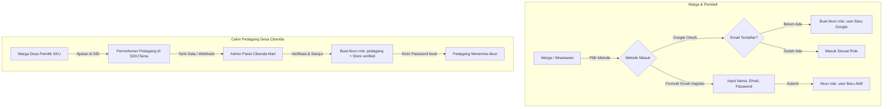
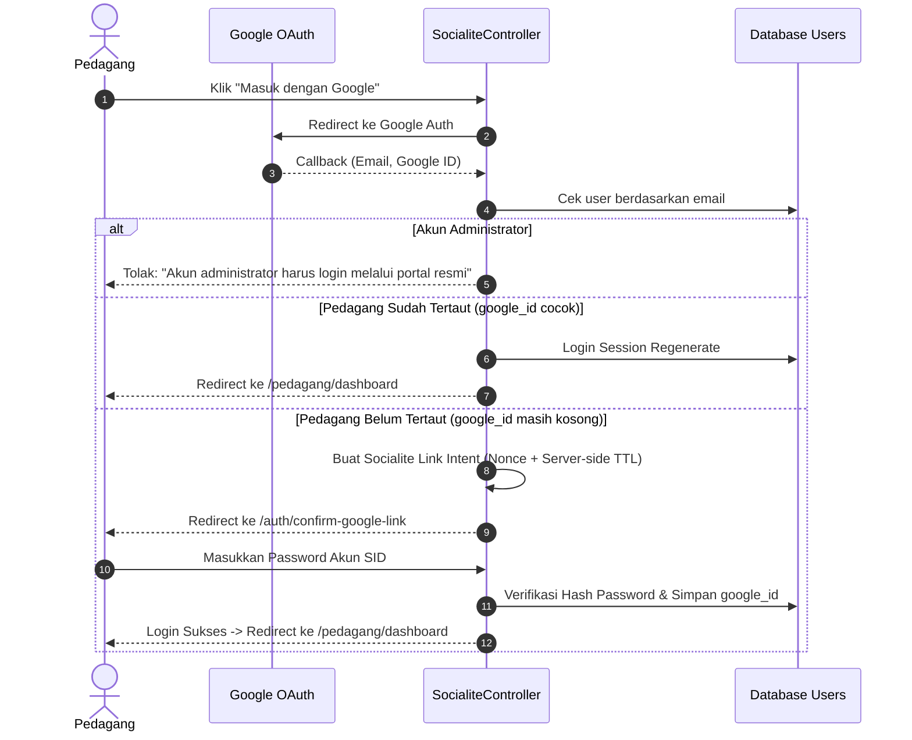
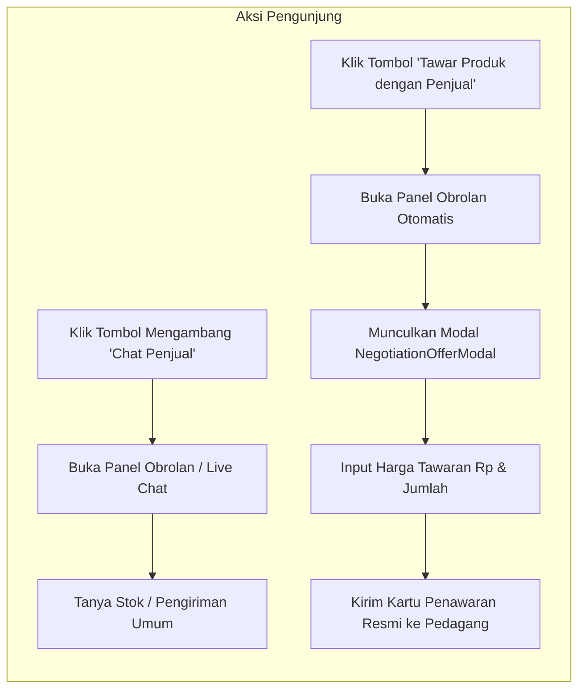

# Panduan Arsitektur Akun, Otentikasi, dan Hak Akses Cibenda Mart
Pemerintah Desa Cibenda, Kecamatan Parigi, Kabupaten Pangandaran

Dokumen ini menjelaskan arsitektur akun pengguna, alur otentikasi (Google OAuth 2.0 dan kredensial lokal), integrasi pendaftaran pedagang via SID (Sistem Informasi Desa), rekonsiliasi akun pedagang dengan Google, serta aturan proteksi transaksi di platform Cibenda Mart.

---

## 1. Matriks Peran Pengguna (Role-Based Access Control)

Sistem Cibenda Mart memiliki 3 peran utama pengguna yang tersimpan di kolom `role` pada tabel `users`:

| Peran | Nilai Kolom `role` | Metode Pendaftaran | Akses Dashboard | Hak Akses Etalase Publik |
|---|---|---|---|---|
| **Pembeli (User)** | `user` | Google OAuth 2.0 (Instan) atau Formulir Email (`/register`) | `/dashboard` | Menjelajah, membeli, menawar, mengulas seluruh toko yang terverifikasi. |
| **Pedagang (Merchant)** | `pedagang` | Kantor Desa via SIDUTama (Verifikasi SKU) atau Jalur Khusus Manual Berita Acara Admin | `/pedagang/dashboard` | Menjelajah seluruh etalase, membeli dari toko lain. **Dilarang transaksi/ulas toko sendiri.** |
| **Administrator Desa** | `admin` | CLI Aman `php artisan admin:init` | `/{adminPrefix}/dashboard` | Mengelola data desa, persetujuan pedagang, pengaturan platform. Dilarang login via Google. |

---

## 2. Alur Pendaftaran Akun



### 2.1 Pembeli Umum
* Pembeli dapat mendaftar melalui dua metode:
  1. **Masuk dengan Google (OAuth 2.0):** Metode utama yang instan dan terverifikasi otomatis.
     * `role = 'user'`
     * `email_verified_at = now()`
     * `google_id = <ID Google Pengguna>`
     * `password = Hash::make(Str::random(16))`
  2. **Formulir Pendaftaran Email (`/register`):** Disediakan bagi pembeli yang ingin menggunakan kredensial email dan password secara langsung.
     * `role = 'user'`
     * `password = Hash::make(<Password Pilihan>)`
     * Akun langsung aktif untuk memungkinkan transaksi belanja dan pesanan logistik desa tanpa kendala gateway email di area berjarak sinyal minim (AUTH-01). Pemulihan akun tetap aman difasilitasi melalui mekanisme reset password ke email terdaftar.

### 2.2 Pedagang (Warga Desa Cibenda)
* Sesuai regulasi desa, pedagang **tidak dapat mendaftar mandiri secara terbuka** di website etalase guna mencegah pedagang fiktif atau produk ilegal di luar wilayah Cibenda.
* Calon pedagang harus merupakan warga Desa Cibenda yang memiliki **Surat Keterangan Usaha (SKU)** dari Kantor Desa melalui aplikasi SIDUTama.
* Admin desa memverifikasi legalitas usaha di dashboard `admin.merchants.create`.
* Saat disetujui, sistem menerbitkan akun pengguna dengan:
  * `role = 'pedagang'`
  * `nik = <16 Digit NIK Warga>`
  * `email = <Email Pedagang>`
  * `password = Hash::make(<Password Awal>)`
  * `is_password_changed = false`
* Bersamaan dengan itu, dibuat entri toko (`stores`) dengan status `sid_status = 'verified'`.

---

## 3. Rekonsiliasi Akun Pedagang dengan Google OAuth

### 3.1 Latar Belakang Masalah
Pedagang didaftarkan oleh admin desa dengan alamat email aktif mereka (misal: `ibu.lilis@gmail.com`). Ketika pedagang ingin masuk ke platform, mereka sering kali memilih tombol **"Masuk dengan Google"** menggunakan akun Google yang sama alih-alih mengetik email dan kata sandi manual.

Sebelumnya, sistem menolak login tersebut dengan pesan error *"Akun ini tidak bisa dipakai untuk login sebagai pembeli"* karena validasi membatasi Socialite hanya untuk `role === 'user'`.

### 3.2 Alur Penautan Akun (Account Linking Flow)
Sistem sekarang mendukung login Google untuk pedagang dengan perlindungan verifikasi kepemilikan akun:



### 3.3 Penanganan Khusus Peran Administrator
Akun dengan `role === 'admin'` **dilarang mutlak** login via Google Socialite umum. Jika email admin dicoba untuk login via Google, sistem memutus alur dengan pesan:
> *"Akun administrator harus login melalui portal resmi."*
Admin desa wajib login melalui portal terisolasi dengan proteksi kredensial multi-faktor.

---

## 4. Akses Multi-Peran: Pedagang Menjelajah Etalase Publik

Pedagang adalah pelaku usaha sekaligus warga masyarakat. Platform memberikan fleksibilitas bagi pedagang untuk berbelanja kebutuhan dari sesama pedagang lokal di Desa Cibenda.

### 4.1 Halaman yang Dibuka untuk Pedagang
Pedagang yang sedang login dapat mengakses:
* `/shop` (Katalog Etalase Belanja)
* `/product/{slug}` (Detail Produk Toko Lain)
* `/cart` (Keranjang Belanja)
* `/history` (Riwayat Transaksi Pribadi)
* `/about`, `/kebijakan/*` (Halaman Legalitas dan Informasi)
* Navigasi di dashboard pedagang menyediakan tombol **"Belanja Produk"** untuk langsung menuju etalase.

### 4.2 Aturan Integritas & Anti-Fraud (Self-Dealing Guard)
Untuk menjaga keabsahan transaksi, akurasi ulasan, dan mencegah manipulasi algoritma:

1. **Anti Self-Cart & Checkout:**
   * Pedagang dilarang menambahkan produk tokonya sendiri ke dalam keranjang (`CartController::store`).
   * Jika produk sendiri diakses di halaman detail produk:
     * Muncul banner informasi amber: *"Ini adalah produk dari toko Anda sendiri. Pembelian dan penawaran dinonaktifkan."*
     * Tombol **Beli Sekarang**, **+ Keranjang**, dan **Tawar Produk** otomatis berstatus `disabled`.
     * Upaya klik langsung memicu notifikasi toast: *"Anda tidak dapat membeli produk dari toko Anda sendiri."*
   * Pada level checkout (`CheckoutController::index` dan `store`), jika ada item dari toko sendiri di keranjang, transaksi langsung dibatalkan dan diarahkan kembali ke keranjang dengan pesan peringatan.

2. **Anti Self-Review (Ulasan Palsu):**
   * Pedagang tidak dapat menulis ulasan atau memberikan rating bintang untuk barang dari toko miliknya sendiri (`ProductReviewController::create` dan `store`).

3. **Anti Self-Chat & Negotiation:**
   * Pedagang dilarang membuka ruang chat atau mengirim penawaran harga ke tokonya sendiri (`ChatController::createRoom` dan `NegotiationController::store`).

---

## 5. Alur Interaksi Chat & Tawar Produk

Halaman produk menyediakan dua jalur komunikasi terpisah dengan tujuan spesifik:



* **Tombol "Chat Penjual":** Membuka panel live chat untuk percakapan umum.
* **Tombol "Tawar Produk dengan Penjual":** Membuka panel obrolan dan **langsung menampilkan formulir penawaran** (`NegotiationOfferModal`). Pembeli dapat memasukkan harga yang diinginkan, melihat estimasi hemat, dan mengirimkan kartu negosiasi ke penjual dalam satu langkah.

---

## 6. Prosedur Operasional Kantor Desa & Bantuan Pengguna

### Kasus 1: Pedagang Lupa Password Awal Saat Mau Tautkan Akun Google
1. Admin desa membuka menu **Manajemen Pedagang** di Dashboard Admin.
2. Cari pedagang yang bersangkutan berdasarkan nama atau NIK.
3. Klik tombol **Edit Data Pedagang** atau gunakan fitur reset sandi.
4. Berikan password sementara baru kepada pedagang.
5. Pedagang mencoba login Google kembali dan memasukkan password sementara tersebut pada halaman konfirmasi.

### Kasus 2: Penautan Akun Google Gagal / Akun Google Tertukar
* Jika akun Google pedagang tidak sengaja tertaut ke email lain, admin sistem dapat menghapus nilai pada kolom `google_id` pedagang terkait di database:
  ```sql
  UPDATE users SET google_id = NULL WHERE id = <ID_PEDAGANG>;
  ```
* Setelah `google_id` bernilai `NULL`, pedagang dapat mengulangi alur taut akun dengan akun Google yang benar.

---

## 7. Referensi Kode Terkait

* **Otentikasi Google & Intent Linking:** [SocialiteController.php](file:///mnt/data/Projects/Web/React/e-commerce_platform_pangandaran/app/Http/Controllers/Auth/SocialiteController.php)
* **Logika Aksi Produk di Frontend:** [ProductActions.tsx](file:///mnt/data/Projects/Web/React/e-commerce_platform_pangandaran/resources/js/Components/Storefront/ProductDetail/ProductActions.tsx)
* **Widget Live Chat & Auto-Negotiation:** [StorefrontChatWidget.tsx](file:///mnt/data/Projects/Web/React/e-commerce_platform_pangandaran/resources/js/Components/Storefront/LiveChat/StorefrontChatWidget.tsx)
* **Modal Penawaran Negosiasi:** [NegotiationOfferModal.tsx](file:///mnt/data/Projects/Web/React/e-commerce_platform_pangandaran/resources/js/Components/Storefront/LiveChat/NegotiationOfferModal.tsx)
* **Pencegahan Self-Transaction Backend:**
  * Keranjang: [CartController.php](file:///mnt/data/Projects/Web/React/e-commerce_platform_pangandaran/app/Http/Controllers/CartController.php#L137-L141)
  * Checkout: [CheckoutController.php](file:///mnt/data/Projects/Web/React/e-commerce_platform_pangandaran/app/Http/Controllers/CheckoutController.php#L32-L42)
  * Ulasan: [ProductReviewController.php](file:///mnt/data/Projects/Web/React/e-commerce_platform_pangandaran/app/Http/Controllers/ProductReviewController.php#L36-L46)
  * Negosiasi: [NegotiationController.php](file:///mnt/data/Projects/Web/React/e-commerce_platform_pangandaran/app/Http/Controllers/Storefront/NegotiationController.php#L40-L46)
* **Pengujian Otomatis:** [MerchantStorefrontAccessTest.php](file:///mnt/data/Projects/Web/React/e-commerce_platform_pangandaran/tests/Feature/MerchantStorefrontAccessTest.php)
