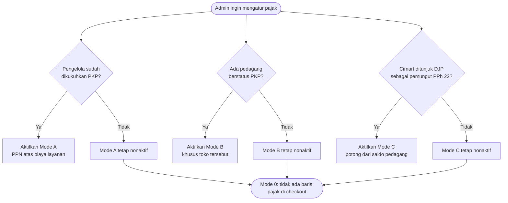
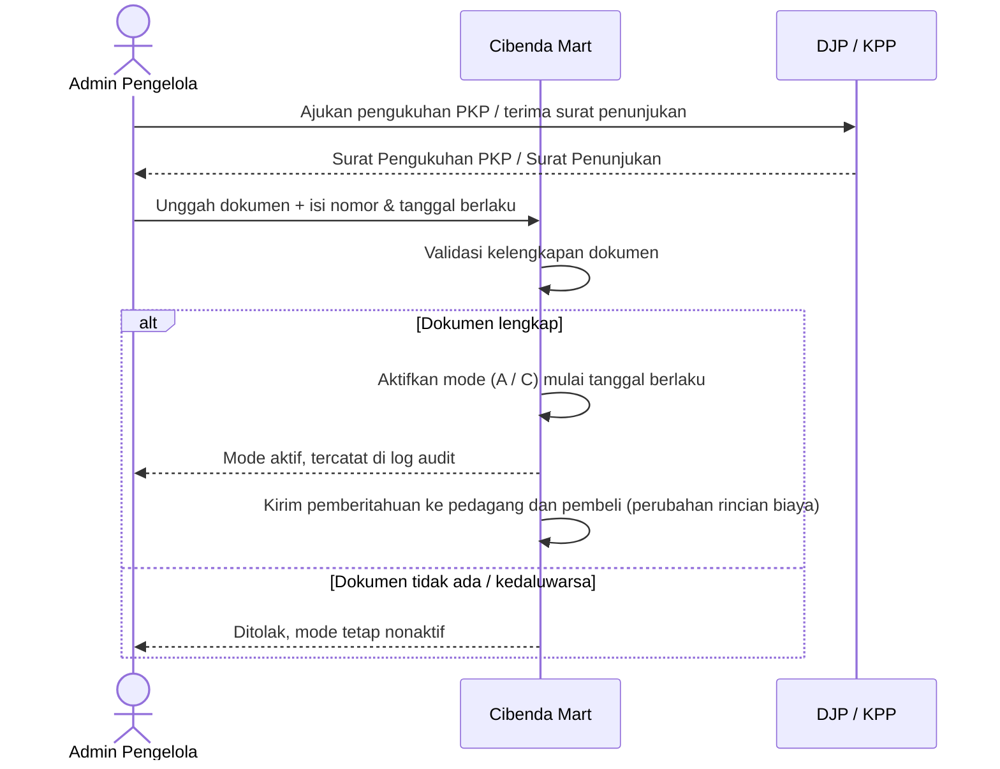
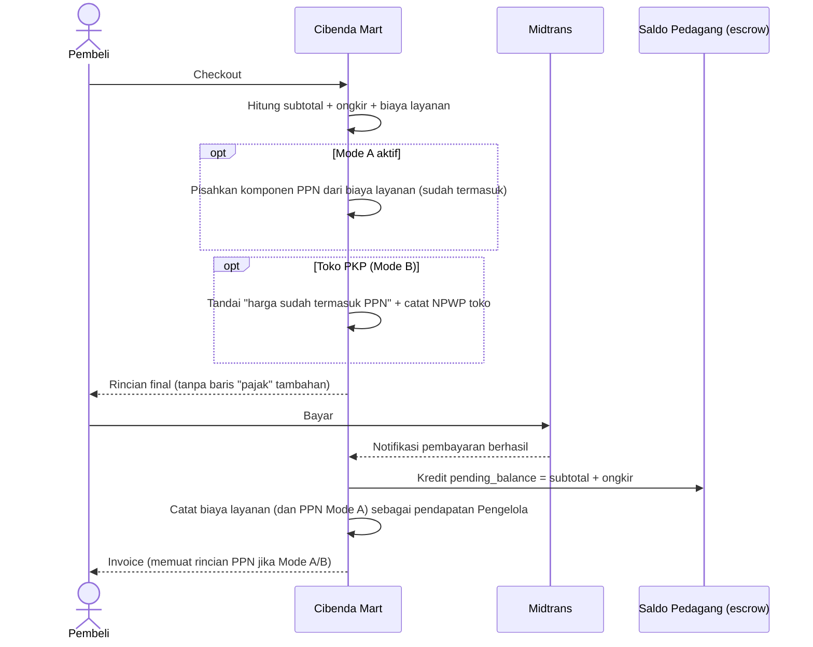
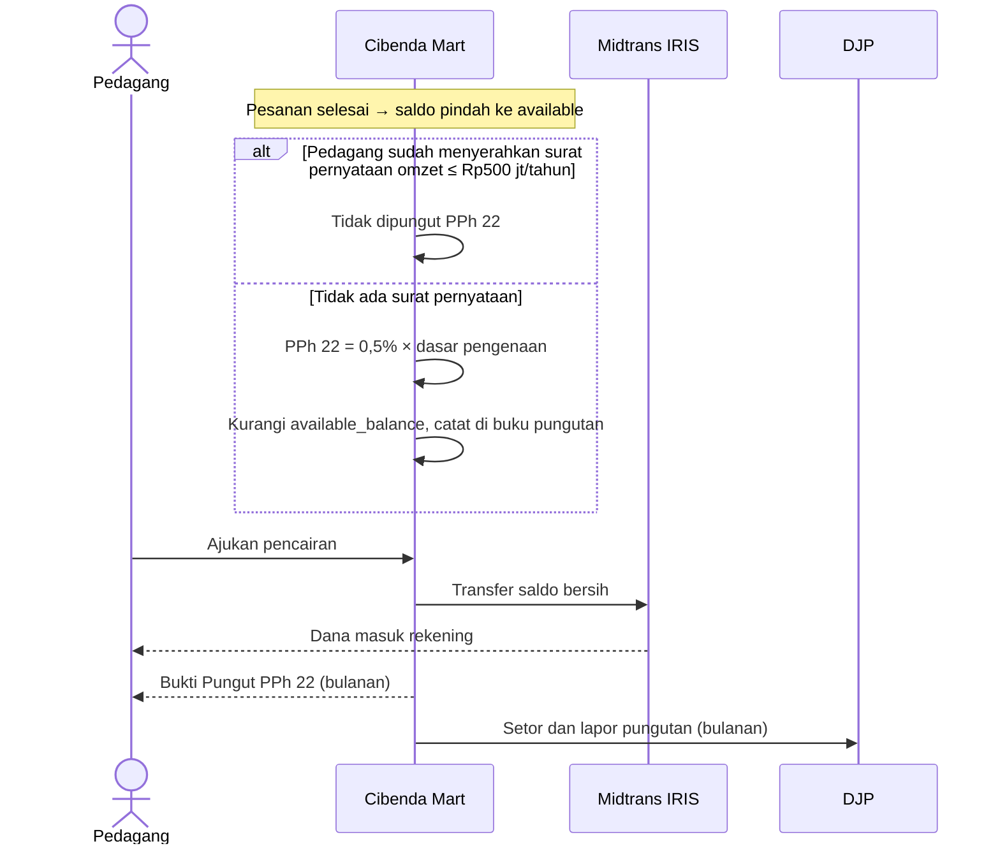
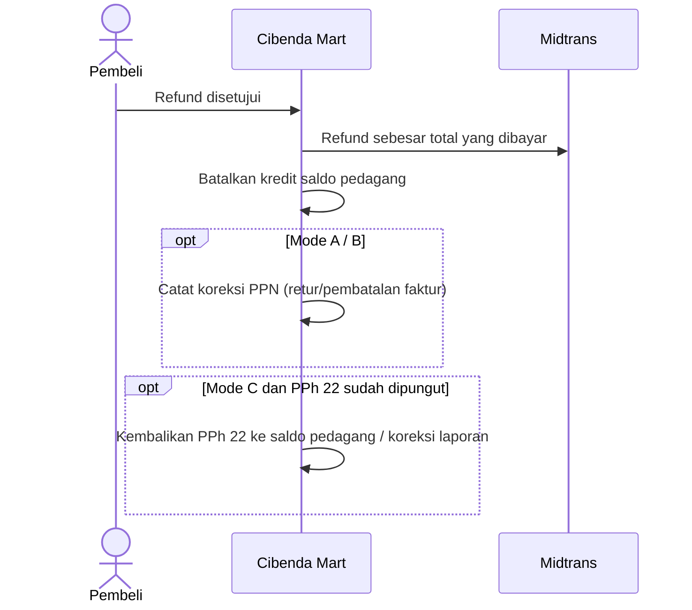

# Business Workflow Pajak — Cibenda Mart

| | |
|---|---|
| **Status** | Rancangan (belum diimplementasikan) |
| **Pemilik** | Pengelola Cibenda Mart (Pemerintah Desa Cibenda) |
| **Tanggal** | November 2026 |
| **Berlaku untuk** | Checkout, pembayaran, saldo pedagang, pencairan dana |

---

## 1. Prinsip

1. **Tidak ada pungutan pajak tanpa dasar hukum.** Platform hanya menagih atau memotong pajak jika berstatus PKP atau ditunjuk resmi oleh DJP.
2. **Pajak atas barang adalah urusan pedagang.** Pajak atas biaya layanan adalah urusan Pengelola.
3. **PPh 22 dipotong dari penghasilan pedagang**, tidak ditambahkan ke tagihan pembeli.
4. **Harga yang dilihat pembeli adalah harga final.** Semua komponen ditampilkan sebelum membayar.

---

## 2. Mode Pajak

Setiap mode **aktif secara terpisah**, hanya jika syarat dokumennya terpenuhi. Beberapa mode boleh aktif bersamaan.

| Mode | Kapan berlaku | Syarat dokumen | Siapa menanggung | Uang pajak ke mana |
|---|---|---|---|---|
| **0 — Tanpa Pajak** *(kondisi saat ini)* | Pengelola bukan PKP dan tidak ditunjuk DJP | — | — | — |
| **A — PPN Biaya Layanan** | Pengelola dikukuhkan sebagai PKP | Surat Pengukuhan PKP Pengelola | Pembeli (sudah termasuk dalam biaya layanan) | Pengelola menyetor ke negara |
| **B — PPN Barang** | Pedagang tertentu berstatus PKP | Surat Pengukuhan PKP pedagang + NPWP | Pembeli (sudah termasuk dalam harga produk) | **Pedagang** menyetor ke negara |
| **C — PPh 22 Marketplace** | Cimart ditunjuk DJP (PMK 37/2025) | Surat Penunjukan dari DJP | Pedagang (dipotong dari saldo) | Pengelola memungut lalu menyetor |

### Penentuan mode

---

## 3. Ilustrasi Aliran Uang

Contoh: subtotal produk **Rp100.000**, ongkir **Rp10.000**, biaya layanan **Rp1.000**.

| Komponen | Mode 0 | Mode A | Mode B | Mode C |
|---|---|---|---|---|
| Dibayar pembeli | 111.000 | 111.000 | 111.000 | 111.000 |
| Diterima pedagang | 110.000 | 110.000 | 110.000 ¹ | 109.500 ² |
| Diterima Pengelola | 1.000 | 901 | 1.000 | 1.000 |
| Disetor ke negara | — | 99 (oleh Pengelola) | 9.910 (oleh pedagang) | 500 (oleh Pengelola) |

¹ Harga Rp100.000 sudah termasuk PPN milik pedagang. Pedagang yang menyetor PPN tersebut.
² Rp110.000 − PPh 22 0,5% × Rp100.000. Perlu dikonfirmasi ke KPP apakah ongkir ikut menjadi dasar pengenaan.

Ilustrasi memakai tarif efektif PPN 11% (12% × DPP 11/12). **Tarif harus dicek ulang** setiap kali mode diaktifkan.

> **Perbedaan dengan kode saat ini:** `tax_amount` = % × subtotal, **ditambahkan ke tagihan pembeli** dan **ditahan platform**. Cara ini tidak sesuai dengan mode mana pun di atas, jadi `enable_tax` harus tetap **OFF** sampai alur ini diimplementasikan.

---

## 4. Sequence Diagram

### 4.1 Aktivasi mode pajak oleh Admin (gerbang dokumen)

### 4.2 Checkout dan pembayaran (Mode 0 / A / B)

### 4.3 Penyelesaian pesanan dan pencairan (Mode C)

### 4.4 Pembatalan / refund (semua mode)

---

## 5. Data Minimum yang Dibutuhkan

| Pihak | Data | Untuk mode |
|---|---|---|
| Pengelola | NPWP, nomor & tanggal Pengukuhan PKP | A |
| Pengelola | Nomor & tanggal Surat Penunjukan DJP | C |
| Toko | Status PKP, NPWP, nomor pengukuhan | B |
| Toko | NPWP/NIK, surat pernyataan omzet (opsional) | C |
| Pesanan | Rincian DPP & PPN per komponen, PPh 22 terpungut | A, B, C |

---

## 6. Keputusan yang Masih Terbuka

1. Status PKP Pengelola saat ini (konfirmasi ke KPP Pratama setempat).
2. Biaya layanan ditampilkan **sudah termasuk PPN** (direkomendasikan) atau ditambahkan terpisah.
3. Perlakuan PPh 22 untuk pesanan **COD**, karena uangnya tidak melewati escrow.
4. Apakah ongkir termasuk dasar pengenaan PPh 22.
5. Format faktur atau bukti pungut yang diterbitkan lewat Coretax.

## 7. Dasar Hukum Rujukan

- UU 7/2021 (HPP) dan PMK 131/2024: tarif PPN dan DPP nilai lain
- PMK 37/2025: penunjukan pemungut PPh 22 oleh penyelenggara PMSE
- PP 55/2022: PPh final UMKM (pedagang)
- UU 8/1999 (Perlindungan Konsumen) dan PP 80/2019 (PMSE): kejelasan harga final
