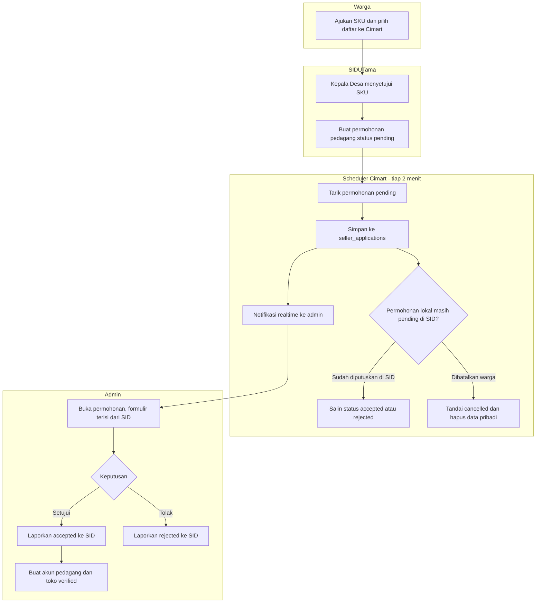
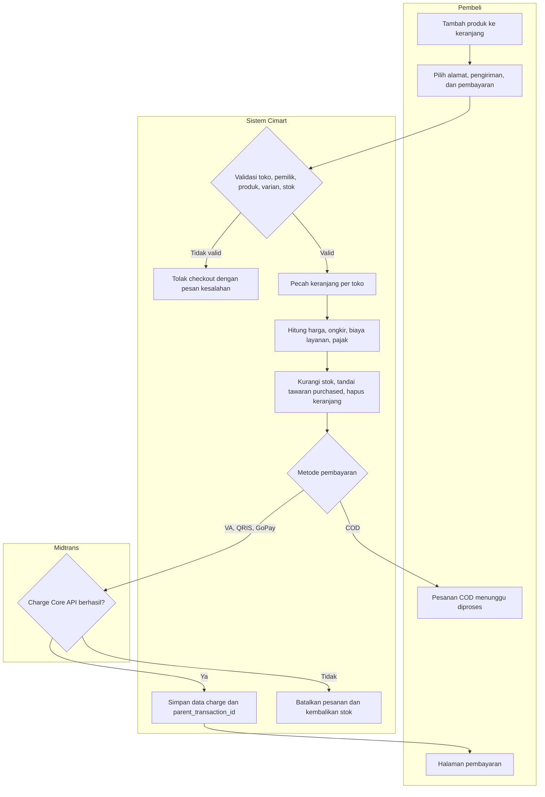
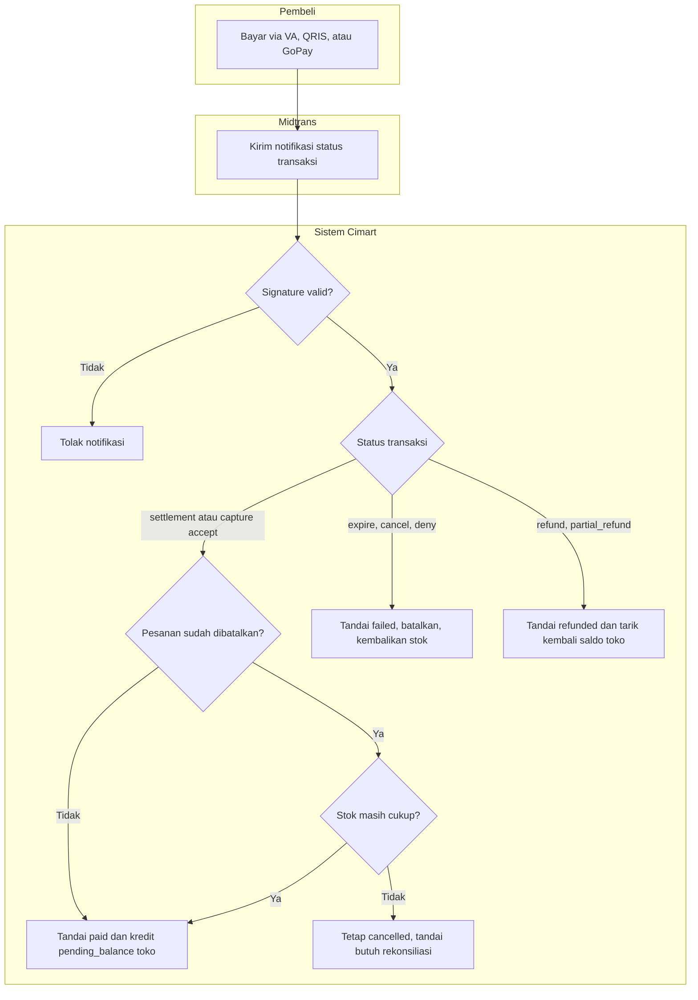
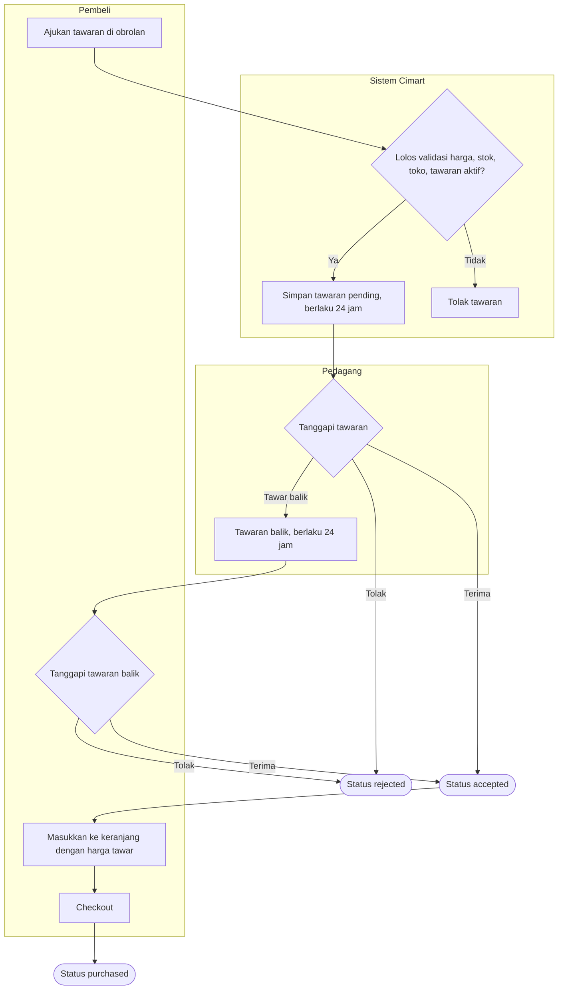
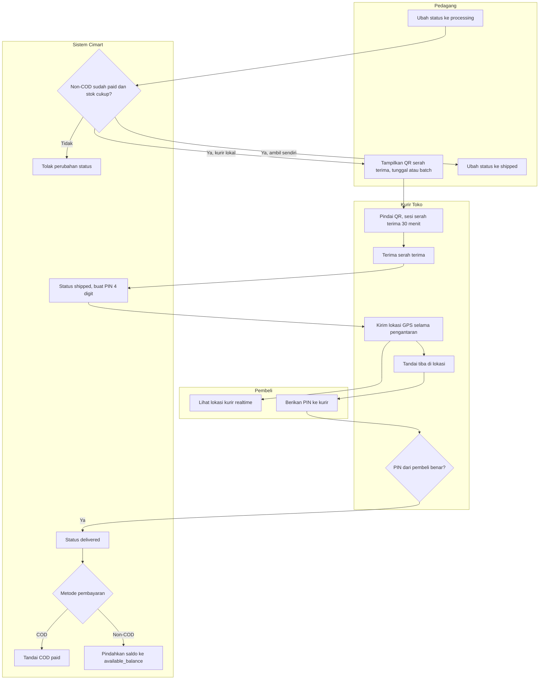
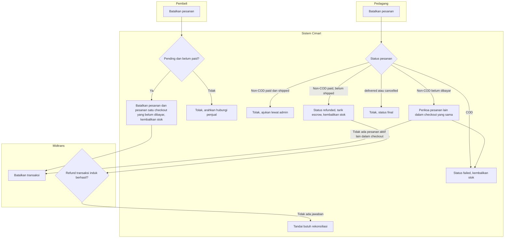
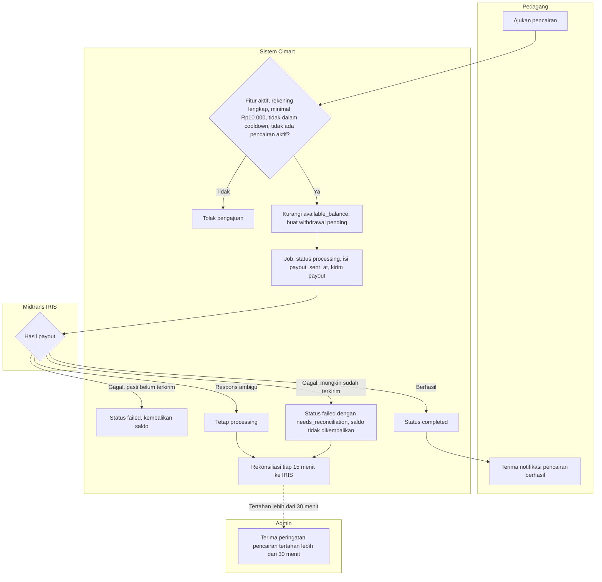

# Business Workflow - Cibenda Mart

| Field | Detail |
|---|---|
| Versi | 1.0 |
| Tanggal | 20 November 2026 |
| Status | Aktif |
| Pemilik Dokumen | Project Manager |
| Dokumen Terkait | `../../data_dictionary/index.md`, `../../PANDUAN_AKUN_DAN_AUTENTIKASI.md`, `../../sid-thirdparty.md`, `../../S&K/` |

Dokumen ini mencatat proses bisnis yang berjalan pada aplikasi. Proses yang memiliki percabangan dilengkapi diagram aktivitas. Setiap subgraph pada diagram mewakili satu aktor.

## Daftar Proses

| No | Proses | Diagram |
|---|---|---|
| 1 | Pendaftaran Pedagang melalui SID | Ya |
| 2 | Penyiapan Toko dan Pengelolaan Produk | - |
| 3 | Belanja dan Checkout | Ya |
| 4 | Pembayaran dan Escrow | Ya |
| 5 | Tawar-Menawar Harga | Ya |
| 6 | Pemrosesan Pesanan dan Pengiriman | Ya |
| 7 | Penyelesaian Pesanan dan Ulasan | - |
| 8 | Pembatalan dan Pengembalian Dana | Ya |
| 9 | Pencairan Saldo Pedagang | Ya |
| 10 | Pengaturan Platform | - |
| 11 | Pengelolaan Pedagang dan Laporan | - |
| 12 | Akun dan Autentikasi | - |

---

## 1. Pendaftaran Pedagang melalui SID

| Elemen | Detail |
|---|---|
| Nama Proses | Pendaftaran Pedagang melalui SID |
| Aktor | Warga (calon pedagang), SIDUTama, Scheduler Cimart, Admin |
| Proses Berjalan | Warga mengajukan Surat Keterangan Usaha (SKU) di SIDUTama dan memilih mendaftar ke Cimart. SIDUTama membuat permohonan berstatus `pending`. Scheduler Cimart menjalankan `SyncSidSellerApplicationsJob` setiap 2 menit untuk mengambil permohonan `pending`, menyimpannya ke `seller_applications`, dan mengirim notifikasi realtime ke admin. Permohonan lokal yang tidak lagi muncul sebagai `pending` dicek ulang ke SID: status `accepted` atau `rejected` disalin, sedangkan permohonan yang dibatalkan warga ditandai `cancelled` dan data pribadinya dihapus. Admin membuka permohonan, melengkapi formulir yang sudah terisi dari data SID (nama toko, password awal), lalu menyetujui atau menolak. Saat menyetujui, Cimart melaporkan status `accepted` ke SID lebih dulu, baru membuat akun `pedagang` dengan `is_password_changed = false` dan toko berstatus `verified`. Saat menolak, Cimart melaporkan status `rejected` ke SID. |
| Hasil | Akun pedagang dan toko terbuat, dan status permohonan di SID dan Cimart sama. Password awal ditetapkan admin dan tidak dikirim otomatis oleh aplikasi. |
| Sumber | `app/Jobs/SyncSidSellerApplicationsJob.php`, `app/Http/Controllers/Admin/MerchantController.php`, `app/Services/Sid/SidApiService.php`, `routes/console.php` |

---

## 2. Penyiapan Toko dan Pengelolaan Produk

| Elemen | Detail |
|---|---|
| Nama Proses | Penyiapan Toko dan Pengelolaan Produk |
| Aktor | Pedagang |
| Proses Berjalan | Selama toko belum disiapkan atau password awal belum diganti, middleware `CheckMerchantSetup` mengarahkan pedagang ke halaman penyiapan toko. Pedagang mengisi nama toko dan password baru, lalu diarahkan ke dashboard dengan tur panduan. Pedagang mengelola produk: nama, kategori, harga, satuan, stok, foto, varian dan SKU, serta opsi pra-pesan. Nama produk, deskripsi, nama varian, pilihan varian, dan nama SKU diperiksa terhadap daftar kata kunci produk terlarang. Produk yang mengandung kata kunci terlarang ditolak. Pembuatan dan perubahan produk disiarkan secara realtime (`ProductStockUpdated`) agar stok di etalase diperbarui. Pedagang juga mengatur profil toko, lokasi, rekening bank, dan preferensi notifikasi. |
| Hasil | Toko aktif dengan produk yang tampil di etalase. |
| Sumber | `app/Http/Middleware/CheckMerchantSetup.php`, `app/Http/Controllers/Merchant/MerchantSetupController.php`, `app/Http/Controllers/Merchant/ProductController.php`, `app/Rules/NoProhibitedKeywords.php`, `app/Services/ProhibitedItemGuardService.php` |

---

## 3. Belanja dan Checkout

| Elemen | Detail |
|---|---|
| Nama Proses | Belanja dan Checkout |
| Aktor | Pembeli, Sistem Cimart, Midtrans |
| Proses Berjalan | Pembeli menjelajah etalase dan menambahkan produk ke keranjang. Produk bervarian wajib memilih SKU yang valid. Saat checkout, pembeli memilih alamat, metode pengiriman (`local_delivery` atau `self_pickup`), dan metode pembayaran (`va`, `qris`, `gopay`, atau `cod`). Pengiriman kurir lokal mensyaratkan alamat dengan titik koordinat. Bila pengaturan `enable_local_delivery` nonaktif, hanya ambil sendiri yang tersedia. Bila `enable_online_payment` nonaktif, hanya COD yang tersedia. Sistem mengunci produk dan keranjang, lalu memeriksa: toko berstatus `verified` dan pemiliknya tidak `suspended` atau `inactive`, pembeli bukan pemilik toko, produk aktif, varian valid, dan stok cukup. Keranjang dipecah menjadi satu pesanan per toko. Harga memakai harga SKU, harga produk, atau harga hasil tawar. Sistem menghitung ongkir, biaya layanan (hanya pada pesanan toko pertama), dan pajak sesuai pengaturan, mengurangi stok, menandai tawaran sebagai `purchased`, lalu menghapus keranjang. Untuk pembayaran non-COD, seluruh pesanan dibayar melalui satu charge Midtrans Core API. ID transaksi Midtrans disimpan sebagai `parent_transaction_id`. Bila charge gagal, pesanan dibatalkan dan stok dikembalikan. |
| Hasil | Pesanan per toko terbentuk. Pembayaran non-COD diarahkan ke halaman pembayaran, sedangkan pesanan COD langsung menunggu diproses pedagang. |
| Sumber | `app/Http/Controllers/CartController.php`, `app/Http/Controllers/CheckoutController.php`, `app/Services/MidtransService.php` |

---

## 4. Pembayaran dan Escrow

| Elemen | Detail |
|---|---|
| Nama Proses | Pembayaran dan Escrow |
| Aktor | Pembeli, Midtrans, Sistem Cimart |
| Proses Berjalan | Pembeli membayar melalui Virtual Account, QRIS, atau GoPay sebelum batas waktu 24 jam. Midtrans mengirim notifikasi ke `/api/midtrans/callback`, dan Cimart memverifikasi signature key-nya. Status `settlement`, atau `capture` dengan fraud status `accept`, mengubah pesanan menjadi `paid` dan menambah `pending_balance` toko sebesar subtotal + ongkir, satu kali per pesanan. Bila pesanan sudah dibatalkan sebelum pembayaran masuk, pesanan hanya diaktifkan kembali jika stok masih cukup; jika tidak, pesanan tetap `cancelled` dan ditandai membutuhkan rekonsiliasi. Status `expire`, `cancel`, atau `deny` mengubah pesanan menjadi `failed`, membatalkan pesanan yang masih `pending`, dan mengembalikan stok. Status `refund` atau `partial_refund` mengubah pesanan menjadi `refunded` dan menarik kembali saldo toko. Pesanan hanya dibatalkan pada refund penuh. Stok hanya dikembalikan pada refund penuh untuk pesanan yang belum `delivered`. Selain menunggu notifikasi, halaman pembayaran meminta status transaksi ke Midtrans saat dibuka dan setiap 4 detik selama pembayaran belum `paid` atau `failed`, dengan hasil di-cache selama 3 detik. Selama pembayaran masih `pending`, pembeli dapat mengalihkan pesanan ke COD: transaksi Midtrans dengan ID induk dibatalkan, lalu metode pembayaran pesanan diubah menjadi `cod`. |
| Hasil | Dana pembeli tertahan sebagai saldo escrow toko sampai pesanan selesai. Pesanan COD tidak melalui escrow. |
| Sumber | `app/Http/Controllers/MidtransCallbackController.php`, `app/Http/Controllers/PaymentController.php`, `app/Services/PaymentSyncService.php`, `app/Models/Order.php` |

---

## 5. Tawar-Menawar Harga

| Elemen | Detail |
|---|---|
| Nama Proses | Tawar-Menawar Harga |
| Aktor | Pembeli, Pedagang |
| Proses Berjalan | Bila `enable_negotiation` aktif, pembeli mengajukan tawaran dari ruang obrolan toko: jumlah, harga tawaran, opsi pra-pesan, dan catatan. Harga tawaran harus lebih rendah dari harga asli dan minimal 30% dari harga asli. Jumlah tidak boleh melebihi stok. Toko harus aktif dan pembeli tidak boleh menawar produk tokonya sendiri. Dalam satu ruang obrolan, satu produk atau varian hanya boleh memiliki satu tawaran aktif (`pending` atau `countered`). Tawaran berlaku 24 jam. Pedagang dapat menerima, menolak, atau mengajukan tawaran balik (minimal Rp100), dan tawaran balik berlaku 24 jam sejak diajukan. Pembeli dapat menerima atau menolak tawaran balik. Tawaran yang sudah `accepted` dimasukkan ke keranjang oleh pembeli dengan harga hasil tawar, lalu diselesaikan melalui checkout biasa. |
| Hasil | Harga hasil tawar dipakai sebagai harga transaksi dan tawaran berstatus `purchased`. |
| Sumber | `app/Http/Controllers/Storefront/NegotiationController.php`, `app/Http/Controllers/Merchant/NegotiationController.php`, `app/Models/ChatNegotiation.php` |

---

## 6. Pemrosesan Pesanan dan Pengiriman

| Elemen | Detail |
|---|---|
| Nama Proses | Pemrosesan Pesanan dan Pengiriman |
| Aktor | Pedagang, Kurir Toko, Pembeli |
| Proses Berjalan | Pedagang mengubah status pesanan dari `pending` ke `processing` lalu `shipped`. Pesanan non-COD harus sudah `paid` dan stok harus mencukupi sebelum diproses atau dikirim. Pesanan `shipped` tidak dapat dikembalikan ke status sebelumnya. Untuk kurir lokal, pedagang menampilkan QR code serah terima, baik per pesanan maupun gabungan beberapa pesanan (batch). Kurir tidak memiliki akun. Kurir memindai QR yang berisi URL bertanda tangan, sehingga terbentuk sesi serah terima 30 menit di perangkatnya. Setelah kurir menerima serah terima, pesanan berubah menjadi `shipped` dan sistem membuat PIN 4 digit untuk pembeli. Selama pengantaran, kurir mengirim lokasi GPS yang ditampilkan secara realtime kepada pembeli. Kurir dapat menandai telah tiba, dan pembeli menerima notifikasi. Di lokasi, kurir memasukkan PIN dari pembeli. Setelah 5 percobaan salah, verifikasi PIN pesanan tersebut dikunci selama 5 menit. PIN yang benar mengubah pesanan menjadi `delivered`. Untuk COD, status pembayaran sekaligus menjadi `paid`. Untuk non-COD, saldo dipindahkan ke `available_balance` toko. Pelacakan hanya tersedia untuk pengiriman kurir lokal. Pesanan ambil sendiri ditandai `shipped` oleh pedagang. |
| Hasil | Pesanan sampai ke pembeli dengan bukti serah terima berupa PIN. |
| Sumber | `app/Http/Controllers/Merchant/OrderController.php`, `app/Http/Controllers/DeliveryTrackerController.php`, `app/Models/Order.php`, `routes/web.php` (rute `/tracker`) |

---

## 7. Penyelesaian Pesanan dan Ulasan

| Elemen | Detail |
|---|---|
| Nama Proses | Penyelesaian Pesanan dan Ulasan |
| Aktor | Pembeli, Kurir Toko, Scheduler Cimart |
| Proses Berjalan | Pesanan `shipped` menjadi `delivered` melalui salah satu jalur berikut. (1) Kurir memasukkan PIN yang benar (Proses 6). (2) Pembeli mengonfirmasi selesai, khusus pesanan non-COD yang sudah `paid`. Untuk ambil sendiri, konfirmasi dapat dilakukan kapan saja. Untuk kurir lokal, konfirmasi dapat dilakukan setelah kurir menandai tiba atau setelah 4 jam sejak pembaruan terakhir. (3) Scheduler setiap 15 menit menyelesaikan otomatis pesanan kurir lokal non-COD yang `paid` dan tidak diperbarui lebih dari 4 jam. Pesanan COD tidak dapat dikonfirmasi pembeli. Setiap penyelesaian non-COD memindahkan saldo dari `pending_balance` ke `available_balance`. Setelah pesanan `delivered`, pembeli dapat memberi ulasan per item: nilai produk 1 sampai 5, nilai penjual, pengiriman, dan kurir, komentar, foto, serta opsi anonim. Satu item hanya dapat diulas sekali dan pedagang tidak dapat mengulas produk tokonya sendiri. |
| Hasil | Transaksi selesai, saldo pedagang dapat dicairkan, dan ulasan tampil di produk. |
| Sumber | `app/Http/Controllers/OrderHistoryController.php`, `app/Models/Order.php` (`canBuyerComplete`, `autoCompleteDelivery`, `creditStoreBalance`), `routes/console.php`, `app/Http/Controllers/ProductReviewController.php` |

---

## 8. Pembatalan dan Pengembalian Dana

| Elemen | Detail |
|---|---|
| Nama Proses | Pembatalan dan Pengembalian Dana |
| Aktor | Pembeli, Pedagang, Midtrans, Sistem Cimart |
| Proses Berjalan | Pembeli dapat membatalkan pesanan yang masih `pending` dan belum `paid`. Pesanan lain dalam checkout yang sama (`parent_transaction_id` sama) yang juga belum dibayar ikut dibatalkan, stok dikembalikan, dan transaksi Midtrans dibatalkan. Pedagang dapat membatalkan pesanan yang belum `delivered`, kecuali pesanan non-COD yang sudah `paid` dan sudah `shipped`. Bila pesanan dibatalkan pedagang dalam keadaan `paid` (non-COD), status pembayaran menjadi `refunded`, saldo escrow ditarik, stok dikembalikan, dan permintaan refund dikirim ke Midtrans memakai ID transaksi induk. Bila Midtrans tidak memberi jawaban, pesanan ditandai membutuhkan rekonsiliasi. Bila pesanan dibatalkan pedagang dalam keadaan belum dibayar, status menjadi `failed`, dan transaksi Midtrans dibatalkan jika tidak ada pesanan lain yang masih aktif dalam checkout yang sama. Aplikasi tidak memiliki fitur pengajuan keluhan atau refund oleh pembeli. Kebijakan Pengembalian Dana menetapkan Admin sebagai mediator. |
| Hasil | Pesanan berstatus `cancelled`, stok kembali, dan dana dikembalikan melalui gateway untuk pesanan yang sudah dibayar. |
| Sumber | `app/Http/Controllers/OrderHistoryController.php` (`cancel`), `app/Http/Controllers/Merchant/OrderController.php` (`updateStatus`), `app/Services/MidtransService.php`, `resources/js/Pages/Legal/RefundPolicy.tsx` |

---

## 9. Pencairan Saldo Pedagang

| Elemen | Detail |
|---|---|
| Nama Proses | Pencairan Saldo Pedagang |
| Aktor | Pedagang, Sistem Cimart, Midtrans IRIS, Admin |
| Proses Berjalan | Bila `enable_withdrawal` aktif dan data rekening lengkap, pedagang mengajukan pencairan minimal Rp10.000 dari `available_balance`. Pengajuan ditolak bila rekening diubah kurang dari 30 menit sebelumnya, atau bila masih ada pencairan berstatus `pending` atau `processing`. Saldo dikurangi, catatan `withdrawals` berstatus `pending` dibuat, dan job `ProcessWithdrawalPayout` dikirim ke antrean. Job mengubah status menjadi `processing`, mengisi `payout_sent_at`, lalu mengirim payout ke Midtrans IRIS. Bila berhasil, status menjadi `completed` dan pedagang menerima notifikasi. Gangguan gateway dicoba ulang maksimal 3 kali dengan jeda 60, 180, dan 300 detik. Hasil akhirnya bergantung pada kepastian payout: (1) bila payout pasti belum terkirim, status menjadi `failed` dan saldo dikembalikan; (2) bila respons gateway ambigu, status tetap `processing` dan menunggu rekonsiliasi; (3) bila gagal tetapi payout mungkin sudah terkirim, termasuk setelah 3 kali dibatasi rate limit, status menjadi `failed` dengan `needs_reconciliation` dan saldo tidak dikembalikan otomatis. Perintah `withdrawals:reconcile` setiap 15 menit memeriksa status pencairan `processing` dan `failed` bertanda `needs_reconciliation` ke IRIS, lalu memperbarui status dan mengembalikan saldo bila payout gagal. Perintah `withdrawals:alert-stuck` setiap 15 menit memberi tahu admin bila pencairan tersebut tertahan lebih dari 30 menit. |
| Hasil | Dana masuk ke rekening pedagang, atau saldo dikembalikan bila pencairan gagal. |
| Sumber | `app/Http/Controllers/Merchant/WithdrawalController.php`, `app/Jobs/ProcessWithdrawalPayout.php`, `app/Console/Commands/ReconcileWithdrawals.php`, `app/Console/Commands/AlertStuckWithdrawals.php`, `routes/console.php` |

---

## 10. Pengaturan Platform

| Elemen | Detail |
|---|---|
| Nama Proses | Pengaturan Platform |
| Aktor | Admin, Sistem Cimart |
| Proses Berjalan | Admin mengubah pengaturan di halaman pengaturan platform. Kelompok keuangan berisi pajak (aktif/nonaktif dan persentase 0 sampai 100) serta biaya layanan (aktif/nonaktif dan nominal). Kelompok fitur berisi saklar pembayaran online, tawar-menawar, sinkronisasi SIDUTama, pencairan saldo, dan pengiriman kurir lokal. Perubahan disimpan ke `platform_settings`, cache pengaturan dihapus, lalu perubahan disiarkan secara realtime ke klien yang terhubung. Saklar fitur langsung memengaruhi checkout, tawar-menawar, dan pencairan. |
| Hasil | Fitur dan biaya platform dapat diubah tanpa deploy ulang. |
| Sumber | `app/Http/Controllers/Admin/PlatformSettingController.php`, `app/Models/PlatformSetting.php`, `app/Events/PlatformSettingsUpdated.php`, `database/seeders/PlatformSettingSeeder.php` |

---

## 11. Pengelolaan Pedagang dan Laporan

| Elemen | Detail |
|---|---|
| Nama Proses | Pengelolaan Pedagang dan Laporan |
| Aktor | Admin |
| Proses Berjalan | Admin melihat daftar pedagang dan permohonan dari SID, mengubah data pedagang, status akun (`active`, `warning`, `suspended`, `inactive`), dan status verifikasi toko (`verified`, `pending`, `rejected`). Toko yang pemiliknya `suspended` atau `inactive`, atau toko yang tidak `verified`, tidak tampil di etalase dan tidak dapat menerima pesanan maupun tawaran. Akun berstatus `suspended` atau `inactive` ditolak saat login dan dikeluarkan dari sesinya saat membuka halaman yang dilindungi middleware peran atau etalase. Status `warning` tidak membatasi akses. Admin juga dapat menghapus pedagang. Halaman laporan menampilkan peringkat produk terlaris beserta penjualan dan pendapatannya, dengan filter periode, toko, dan kategori. Laporan dapat diekspor ke file CSV. |
| Hasil | Data pedagang terkendali dan admin memiliki rekap penjualan. |
| Sumber | `app/Http/Controllers/Admin/MerchantController.php`, `app/Http/Controllers/Admin/ReportController.php`, `app/Http/Controllers/Admin/DashboardController.php`, `app/Http/Requests/Auth/LoginRequest.php`, `app/Http/Middleware/EnsureUserHasRole.php`, `app/Http/Middleware/RedirectNonUserFromStorefront.php` |

---

## 12. Akun dan Autentikasi

| Elemen | Detail |
|---|---|
| Nama Proses | Akun dan Autentikasi |
| Aktor | Pembeli, Pedagang, Admin |
| Proses Berjalan | Pembeli mendaftar dan masuk dengan akun Google, atau dengan formulir pendaftaran email dan password di `/register`. Pendaftaran dengan email tidak mensyaratkan verifikasi email. Pembeli dapat menghapus akunnya sendiri; pedagang dan admin tidak. Pedagang masuk melalui `/pedagang/login` dengan email dan password dari admin, wajib mengganti password pada login pertama, lalu dapat menautkan akun Google. Admin dibuat melalui perintah `php artisan admin:init`, masuk melalui prefix URL yang dapat dikonfigurasi, dan tidak dapat masuk dengan Google. Pedagang dapat menjelajah etalase dan membeli dari toko lain, tetapi tidak dapat membeli, menawar, atau mengulas produk tokonya sendiri. Rincian alur tercatat di `PANDUAN_AKUN_DAN_AUTENTIKASI.md`. |
| Hasil | Setiap peran masuk melalui jalur yang sesuai. |
| Sumber | `routes/auth.php`, `routes/web.php`, `app/Http/Controllers/Auth/`, `app/Http/Controllers/ProfileController.php` (`destroy`), `app/Console/Commands/AdminInit.php`, `docs/PANDUAN_AKUN_DAN_AUTENTIKASI.md` |
