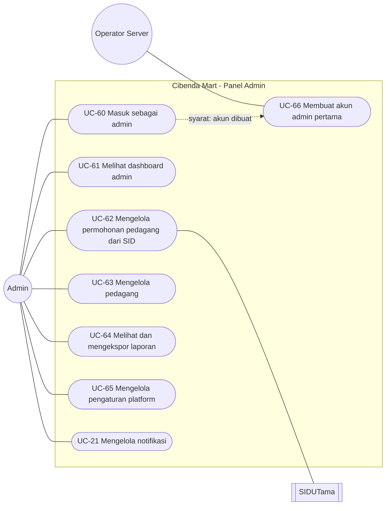
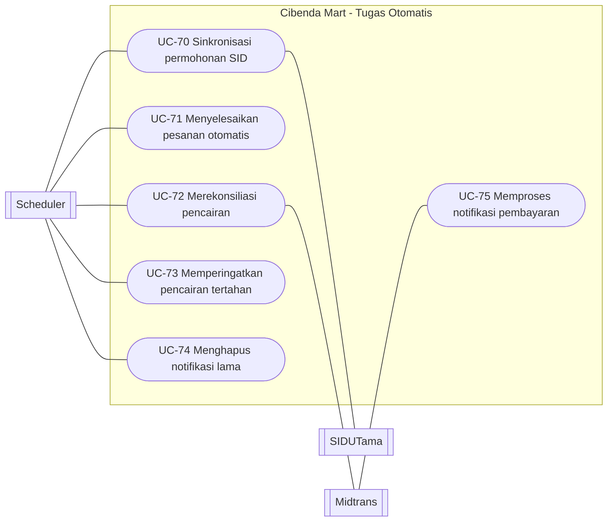

# Use Case - Admin, Operator Server, dan Sistem Otomatis

Sumber: `routes/web.php` (grup `prefix($adminPrefix)` dengan middleware `role:admin`), `app/Console/Commands/AdminInit.php`, `routes/console.php`, `app/Http/Controllers/MidtransCallbackController.php`.

## 1. Admin dan Operator Server

| Use Case | Ketentuan |
|---|---|
| UC-60 | Halaman login di `/{adminPrefix}/login`. Bila prefix bukan `admin`, URL `/admin*`, `/cibenda-admin*`, dan `/login/admin*` mengembalikan 404 |
| UC-62 | Sinkronisasi manual, menyetujui (membuat akun pedagang dan toko), atau menolak dengan alasan. Hasilnya dilaporkan ke SID |
| UC-63 | Mengubah data, status akun (`active`, `warning`, `suspended`, `inactive`), status verifikasi toko, dan menghapus pedagang |
| UC-64 | Peringkat produk terlaris dengan filter periode, toko, dan kategori. Ekspor ke CSV |
| UC-65 | Pajak, biaya layanan, dan saklar fitur. Perubahan disiarkan secara realtime |

## 2. Sistem Otomatis

| Use Case | Jadwal | Ketentuan |
|---|---|---|
| UC-70 | Setiap 2 menit | Mengambil permohonan `pending` dan menyelaraskan status permohonan lokal |
| UC-71 | Setiap 15 menit | Pesanan `shipped`, `local_delivery`, non-COD, `paid`, tidak diperbarui lebih dari 4 jam |
| UC-72 | Setiap 15 menit | Pencairan `processing` atau `failed` dengan `needs_reconciliation` |
| UC-73 | Setiap 15 menit | Memberi tahu admin bila pencairan tertahan lebih dari 30 menit |
| UC-74 | Harian | Menghapus notifikasi lebih tua dari 60 hari |
| UC-75 | Saat notifikasi masuk | Memverifikasi signature dan gross amount, lalu memperbarui status pembayaran |
