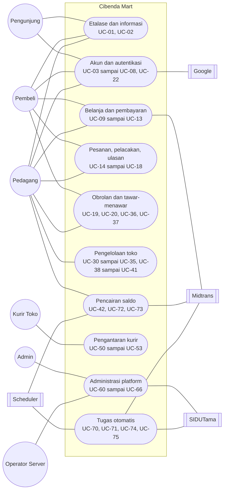

# Use Case Overview - Cibenda Mart

Sumber: `routes/web.php`, `routes/auth.php`, `routes/console.php`. Rincian per use case ada di `00_index.md`.

Pedagang terhubung ke kelompok belanja karena rute pembeli juga dapat diakses peran `pedagang`, dengan pengecualian toko miliknya sendiri.
