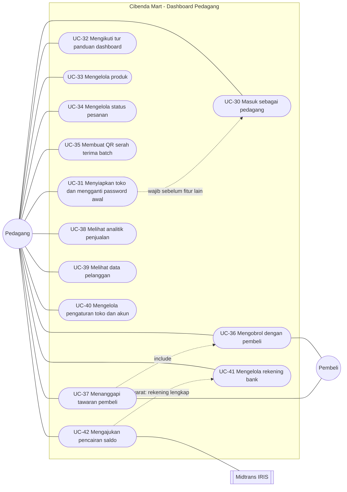

# Use Case - Pedagang

Sumber: `routes/web.php` (grup `prefix('pedagang')` dengan middleware `role:pedagang` dan `CheckMerchantSetup`), `app/Http/Middleware/CheckMerchantSetup.php`.

| Use Case | Ketentuan |
|---|---|
| UC-31 | Selama toko belum disiapkan atau password awal belum diganti, semua halaman pedagang diarahkan ke halaman ini |
| UC-33 | Nama, deskripsi, varian, dan SKU diperiksa terhadap kata kunci produk terlarang |
| UC-34 | Status yang dapat dipilih: `pending`, `processing`, `shipped`, `cancelled`. Pesanan non-COD harus `paid` sebelum diproses. Pesanan `shipped` non-COD yang sudah dibayar tidak dapat dibatalkan |
| UC-35 | Hanya pesanan `local_delivery` berstatus `pending` atau `processing` yang COD atau sudah `paid` |
| UC-37 | Terima, tolak, atau tawar balik minimal Rp100. Hanya bila `enable_negotiation` aktif |
| UC-41 | Perubahan rekening menahan pencairan selama 30 menit |
| UC-42 | Minimal Rp10.000, hanya bila `enable_withdrawal` aktif dan tidak ada pencairan `pending` atau `processing` |

Pedagang juga dapat menjalankan UC-09 sampai UC-21 di `uc_pembeli.md` untuk toko lain.
