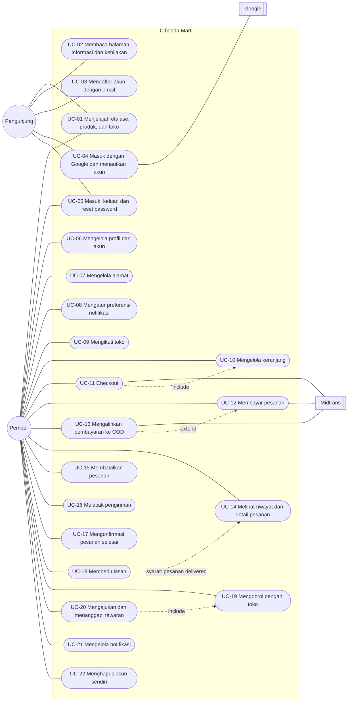
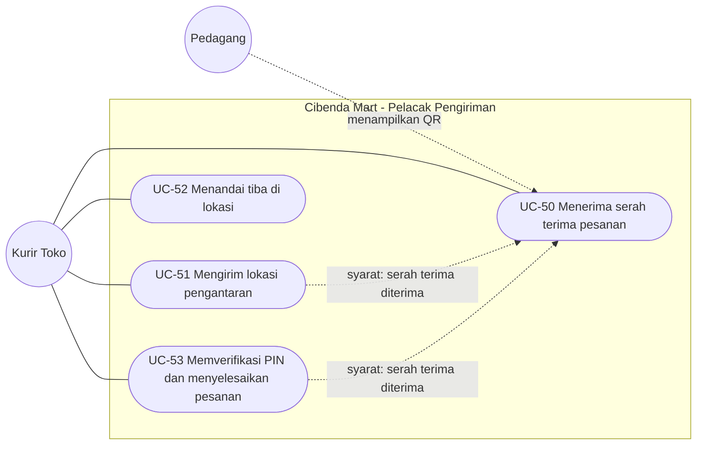

# Use Case - Pengunjung, Pembeli, dan Kurir Toko

Sumber: `routes/web.php` (grup `storefront.user`, `role:user,pedagang`, rute `/tracker`), `routes/auth.php`, `app/Http/Controllers/Auth/SocialiteController.php`, `app/Http/Controllers/DeliveryTrackerController.php`.

## 1. Pengunjung dan Pembeli

| Use Case | Ketentuan |
|---|---|
| UC-01 | Produk dan toko yang tampil berasal dari toko `verified` yang pemiliknya berstatus `active` atau `warning` |
| UC-03 | Tidak mensyaratkan verifikasi email |
| UC-04 | Admin tidak dapat masuk dengan Google. Penautan ke akun yang sudah ada mensyaratkan password akun |
| UC-11 | Keranjang dipecah menjadi satu pesanan per toko. Tidak dapat membeli dari toko sendiri |
| UC-13 | Hanya untuk pesanan non-COD yang masih `pending` |
| UC-15 | Hanya untuk pesanan `pending` yang belum dibayar |
| UC-16 | Hanya untuk pengiriman `local_delivery` |
| UC-17 | Hanya untuk pesanan non-COD `paid` yang `shipped`, dengan syarat waktu untuk kurir lokal |
| UC-18 | Satu ulasan per item pesanan `delivered` |
| UC-20 | Hanya bila `enable_negotiation` aktif |
| UC-22 | Akun pedagang dan admin tidak dapat dihapus sendiri |

## 2. Kurir Toko

| Use Case | Ketentuan |
|---|---|
| UC-50 | QR berisi URL bertanda tangan yang berlaku 24 jam. Pemindaian membuka sesi serah terima 30 menit. Berlaku untuk satu pesanan atau batch |
| UC-53 | Verifikasi dikunci 5 menit setelah 5 percobaan PIN salah |
