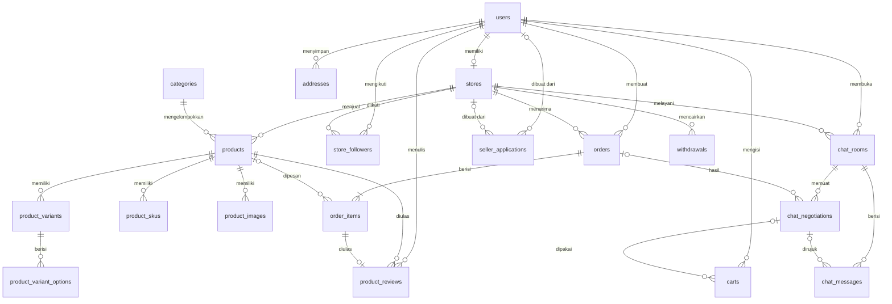
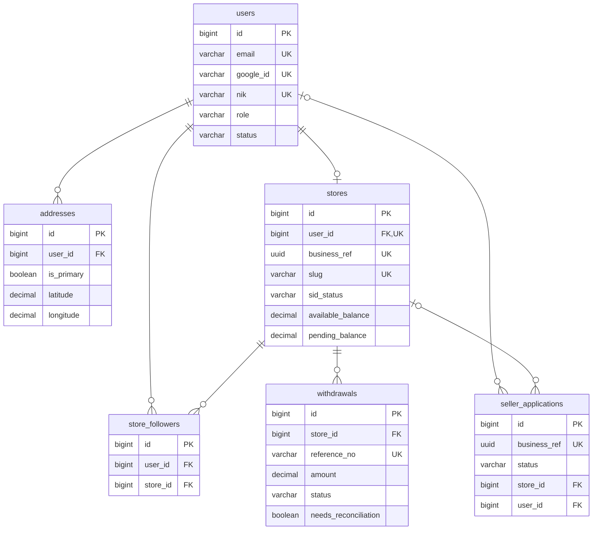
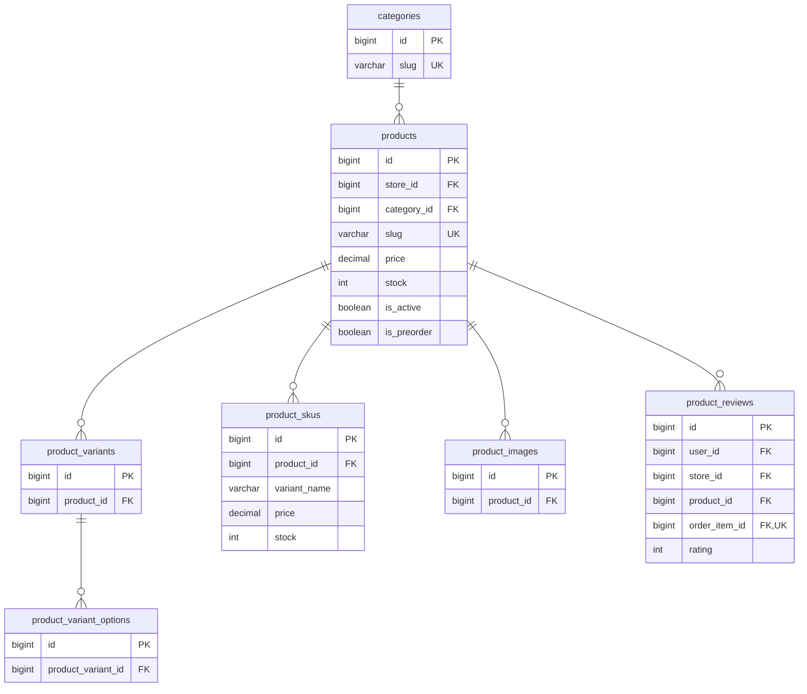
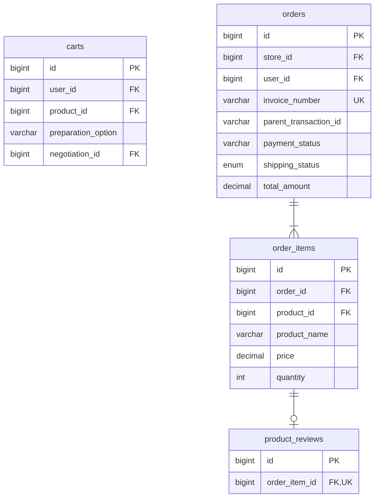
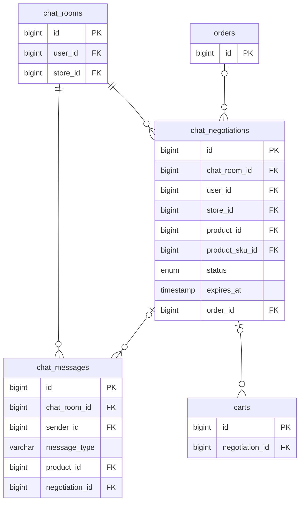

# Entity Relationship Diagram - Cibenda Mart

| Field | Detail |
|---|---|
| Versi | 1.0 |
| Tanggal | 20 November 2026 |
| Status | Aktif |
| Pemilik Dokumen | Project Manager |
| Dokumen Terkait | `index.md` dan seluruh `DD_*.md` |

Sumber: foreign key dan unique constraint pada `database/migrations/`. Tabel bawaan Laravel (`sessions`, `password_reset_tokens`, `cache`, `cache_locks`, `jobs`, `job_batches`, `failed_jobs`) dan `platform_settings` tidak memiliki relasi foreign key, sehingga tidak digambarkan.

## 1. Gambaran Umum

Kardinalitas `users` ke `stores` adalah satu ke nol-atau-satu karena `stores.user_id` bersifat UNIQUE. Kardinalitas `order_items` ke `product_reviews` adalah satu ke nol-atau-satu karena `product_reviews.order_item_id` bersifat UNIQUE.

## 2. Domain Pengguna dan Toko

`stores.business_ref` dan `seller_applications.business_ref` memuat referensi usaha yang sama dari SID. Hubungan ini tidak dikunci dengan foreign key.

## 3. Domain Katalog

## 4. Domain Transaksi

`carts.user_id`, `carts.product_id`, `orders.user_id`, `orders.store_id`, dan `order_items.product_id` merujuk ke `users`, `products`, dan `stores` seperti pada Gambaran Umum. `order_items.product_id` menjadi NULL bila produk dihapus. Pesanan dari satu checkout dikelompokkan melalui `parent_transaction_id` tanpa tabel induk.

## 5. Domain Obrolan dan Tawar-Menawar

Unique: `chat_rooms` (`user_id`, `store_id`), sehingga setiap pasangan pembeli dan toko hanya memiliki satu ruang obrolan.
