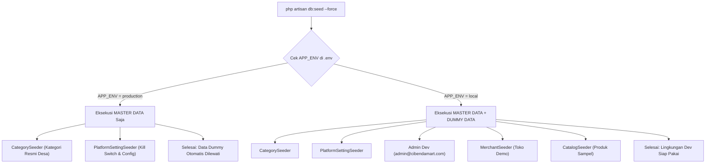

# Panduan Teknis & SOP: Seeder Database & Akun Admin di Lingkungan Production

Dokumen ini adalah panduan resmi dan standar operasional prosedur (SOP) pengelolaan basis data dan inisialisasi akun Super Administrator platform **Cibenda Mart** untuk lingkungan produksi (*production*).

Tujuan utama dokumen ini adalah memberikan kepastian, keamanan data kas desa, dan panduan langkah demi langkah yang bebas dari risiko kesalahan manusia (*human error*).

---

## 1. Prinsip Utama & Latar Belakang Keamanan

### Mengapa Seeder Akun Dilarang Keras di Production?
Pada fase pengembangan (*development*), developer sering menggunakan seeder untuk membuat akun admin cepat dengan kredensial statis seperti:
* Email: `admin@cibendamart.com`
* Password: `password123`

**Bahaya fatal jika seeder ini dijalankan di server Desa Cibenda:**
1. **Kebocoran Kredensial (Security Exploit):** Siapa pun yang melihat repositori Git (atau mantan developer/magang) mengetahui email dan password tersebut. Mereka dapat masuk ke dashboard admin dan memanipulasi keuangan desa, mengubah nomor rekening, atau mencairkan saldo escrow pedagang.
2. **Risiko Overwrite Data Riil:** Jika seeder menggunakan `User::updateOrCreate(['role' => 'admin'])`, setiap kali deployment baru dilakukan dan seeder dijalankan, password admin riil desa bisa ter-reset kembali ke `password123`.
3. **Pencemaran Data Keuangan (Data Pollution):** Seeder demo membuat toko-toko fiktif (misal: *Haji Ujang Seafood*, *Kang Asep Daging*) dan puluhan produk sampel. Jika masuk ke database production, pembukuan keuangan dan transaksi desa menjadi rancu.

---

## 2. Arsitektur Pemisahan Seeder (Master vs Dummy)

Platform Cibenda Mart menerapkan pemisahan ketat antara **Master Data** dan **Dummy Data** yang dikendalikan oleh sistem **Environment Gating**:



### Rincian Perilaku Tiap Seeder:

| Seeder | Kategori | Dijalankan di Production? | Mekanisme Pengamanan |
| :--- | :--- | :---: | :--- |
| `seedCategories()` | Master Data | **YA** | Menggunakan `firstOrCreate`. Kategori resmi (Seafood, Sayuran, Daging, Sembako, dll) hanya dibuat jika belum ada. |
| `PlatformSettingSeeder` | Master Data | **YA** | **Idempoten Selektif:** Jika baris konfigurasi sudah ada, nilai `value` **tidak akan pernah ditimpa**. Hanya memperbarui label dan deskripsi teks hukum. Pengaturan admin riil aman 100%. |
| `seedAdminDevelopment()` | Dummy Data | **TIDAK** | Dipagari `if (! app()->environment('local')) { return; }`. Di production otomatis dilewati. |
| `AdminUserSeeder` | Dummy Data | **TIDAK** | Mengandung guard blokir otomatis di level kelas jika dijalankan di luar environment `local`. |
| `MerchantSeeder` | Dummy Data | **TIDAK** | Berada di bawah *Environment Gate* `DatabaseSeeder.php`. Otomatis dilewati di production. |
| `CatalogSeeder` | Dummy Data | **TIDAK** | Berada di bawah *Environment Gate* `DatabaseSeeder.php`. Otomatis dilewati di production. |

---

## 3. Idempotensi Pengaturan Platform (`PlatformSettingSeeder`)

Banyak tim khawatir: *"Kalau deploy update kode baru lalu kita jalankan `db:seed`, apakah settingan kill switch atau persentase pajak yang sudah diatur Admin Desa akan kembali ke default?"*

**Jawabannya: TIDAK.**

Logika di `PlatformSettingSeeder.php` telah dirancang khusus:
```php
$existing = PlatformSetting::where('key', $setting['key'])->first();

if (! $existing) {
    // Kunci baru dibuat pertama kali dengan nilai default
    PlatformSetting::create($setting);
} else {
    // Kunci yang sudah ada HANYA diperbarui label & deskripsinya.
    // Kolom 'value' sama sekali tidak disentuh!
    $existing->update([
        'type' => $setting['type'],
        'group' => $setting['group'],
        'label' => $setting['label'],
        'description' => $setting['description'],
    ]);
}
```

**Skenario Nyata:**
* Jika Admin Desa mematikan kurir lokal karena cuaca buruk di pesisir Pangandaran (`enable_local_delivery = 0`).
* Kemudian tim teknis melakukan update fitur dan menjalankan `php artisan db:seed --force`.
* Status kurir **tetap 0 (Mati)**, tidak akan berubah menjadi 1.

---

## 4. Inisialisasi Akun Super Admin Production (`admin:init`)

Untuk membuat akun Super Administrator pertama di server production, digunakan perintah resmi:

```bash
php artisan admin:init
```

### Mengapa Menggunakan Artisan Command CLI?
1. **Tidak Ada Password di Git:** Password diketik langsung di terminal server yang diamankan SSH.
2. **Input Rahasia:** Terminal menggunakan `$this->secret()` sehingga ketikan password tidak memantul (*echo*) di layar monitor server.
3. **Validasi Ketat:** Memeriksa format email resmi, memastikan password minimal 8 karakter, dan mewajibkan konfirmasi password yang identik.
4. **Proteksi Duplikasi (Guard):** Secara default, perintah akan **menolak** membuat admin jika di database sudah terdeteksi ada akun admin, mencegah pembuatan admin gelap tanpa izin.

### Dialog Interaktif di Terminal Server:

```text
$ php artisan admin:init

Inisialisasi Akun Super Administrator Cibenda Mart

 Nama Lengkap Administrator [Administrator Desa Cibenda]:
 > Budi Setiawan (Kaur Keuangan Pemdes)

 Alamat Email Resmi (cth: admin@cibenda.desa.id):
 > keuangan@cibenda.desa.id

 Password Administrator (minimal 8 karakter):
 > [Ketik password rahasia]

 Konfirmasi Password:
 > [Ketik ulang password rahasia]

Akun Super Administrator Desa Cibenda berhasil dibuat!

+--------------------+-----------------------------+
| Atribut            | Nilai                       |
+--------------------+-----------------------------+
| Nama               | Budi Setiawan               |
| Email              | keuangan@cibenda.desa.id    |
| Role               | admin                       |
| Status             | active                      |
| Email Terverifikasi| 2026-11-19 06:48:00         |
+--------------------+-----------------------------+

Kredensial disimpan dengan aman. Anda kini dapat login ke panel admin.
```

---

## 5. SOP Deployment Production Langkah demi Langkah

Ikuti urutan persis berikut agar terhindar dari kesalahan:

### A. Persiapan File `.env` Server Production
Pastikan parameter berikut sudah terpasang dengan benar di file `.env` server:

```ini
APP_NAME="Cibenda Mart"
APP_ENV=production
APP_DEBUG=false
APP_URL=https://cibendamart.desa.id
```
> [!CAUTION]
> Nilai `APP_ENV=production` adalah **kunci mutlak**. Nilai inilah yang memicu seluruh proteksi otomatis penolak data dummy.

---

### B. Deployment Pertama Kali (Initial Setup Server Baru)

Jalankan rangkaian perintah berikut di terminal server (atau di dalam container Docker `app_cibenda`):

```bash
# 1. Jalankan struktur tabel basis data
php artisan migrate --force

# 2. Isi Master Data (kategori resmi & kill switch platform)
# Karena APP_ENV=production, seluruh data dummy otomatis dilewati!
php artisan db:seed --force

# 3. Buat akun Super Admin resmi pertama secara interaktif
php artisan admin:init

# 4. Optimalkan cache aplikasi untuk production
php artisan config:cache
php artisan route:cache
php artisan view:cache
```

Jika server menggunakan Docker Compose sesuai `docs/DEPLOYMENT_GUIDE.md`:
```bash
docker compose exec app_cibenda php artisan migrate --force
docker compose exec app_cibenda php artisan db:seed --force
docker compose exec app_cibenda php artisan admin:init
```

---

### C. Deployment Rutin (Saat Ada Update / Rilis Fitur Baru)

Ketika ada update kode dari Git di masa mendatang, jalankan:

```bash
# 1. Tarik kode terbaru
git pull origin main

# 2. Jalankan migrasi tabel baru (jika ada perubahan skema)
php artisan migrate --force

# 3. Sinkronkan seeder master data (jika ada kategori baru / kill switch baru)
# Aman dijalankan: tidak akan menimpa pengaturan lama admin!
php artisan db:seed --force

# 4. Refresh cache
php artisan optimize:clear
php artisan config:cache
php artisan route:cache
php artisan view:cache
```

---

## 6. Panduan Penanganan Masalah & FAQ (Troubleshooting)

### Q1: "Bagaimana jika Admin Desa lupa password akun produksinya?"
**Solusi:**
Gunakan perintah `admin:init` dengan flag `--force`:
```bash
php artisan admin:init --force
```
Masukkan email admin yang bersangkutan dan ketikkan password baru. Sistem akan memperbarui password akun tersebut tanpa menghapus data riwayat transaksi atau audit log admin.

### Q2: "Bagaimana jika Pemdes ingin menambah Administrator kedua (misal: Sekretaris Desa)?"
**Solusi:**
Sama seperti di atas, jalankan dengan flag `--force`:
```bash
php artisan admin:init --force
```
Masukkan nama dan email admin kedua (misal: `sekdes@cibenda.desa.id`). Sistem akan mendeteksi email baru dan mendaftarkannya sebagai administrator kedua.

### Q3: "Bagaimana jika saya tidak sengaja menjalankan `php artisan db:seed --force` di server production?"
**Solusi:**
**Tenang, tidak ada data rusak atau bocor.**
Sistem memiliki pengaman berlapis:
1. `APP_ENV=production` langsung memblokir `seedAdminDevelopment()`, `MerchantSeeder`, dan `CatalogSeeder`. Tidak ada akun demo atau produk fiktif yang terbuat.
2. Pengaturan platform yang sudah diubah di dashboard tetap utuh karena dilindungi oleh seleksi idempoten `PlatformSettingSeeder`.

### Q4: "Bagaimana cara memastikan di database production tidak ada akun dummy?"
**Solusi:**
Jalankan perintah pengecekan via tinker di server:
```bash
php artisan tinker --execute="echo 'Jumlah Admin: ' . App\Models\User::where('role', 'admin')->count() . ' | Email Admin: ' . App\Models\User::where('role', 'admin')->pluck('email')->join(', ') . PHP_EOL;"
```
Pastikan email yang muncul **hanya** email resmi Pemdes Cibenda dan tidak ada `admin@cibendamart.com`.
