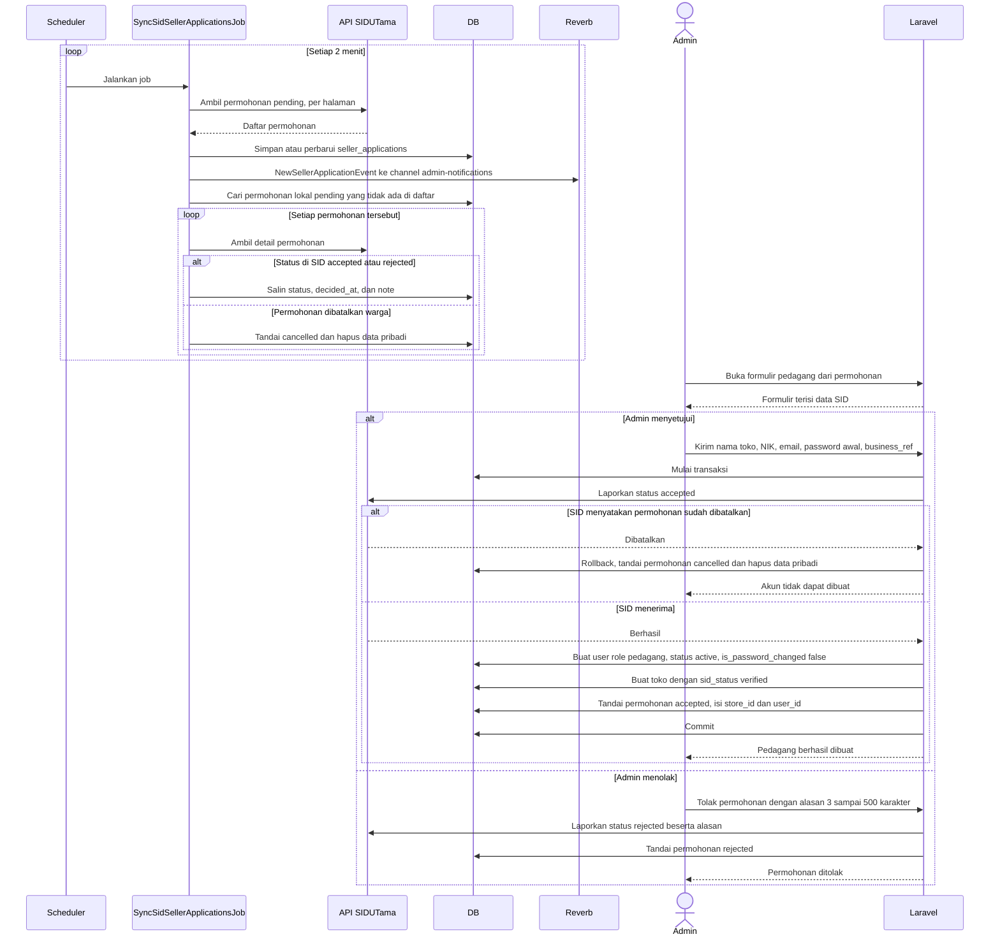

# Sequence 01 - Sinkronisasi SID dan Pembuatan Akun Pedagang

| Field | Detail |
|---|---|
| Proses BW | 1. Pendaftaran Pedagang melalui SID |
| Aktor | Scheduler, Admin |
| Sumber | `routes/console.php`, `app/Jobs/SyncSidSellerApplicationsJob.php`, `app/Services/Sid/SidApiService.php`, `app/Http/Controllers/Admin/MerchantController.php` (`store`, `rejectApplication`), `app/Events/NewSellerApplicationEvent.php` |

Status `accepted` dilaporkan ke SID di dalam transaksi database, sebelum akun lokal dibuat. Bila pelaporan gagal, transaksi dibatalkan dan akun tidak dibuat.
