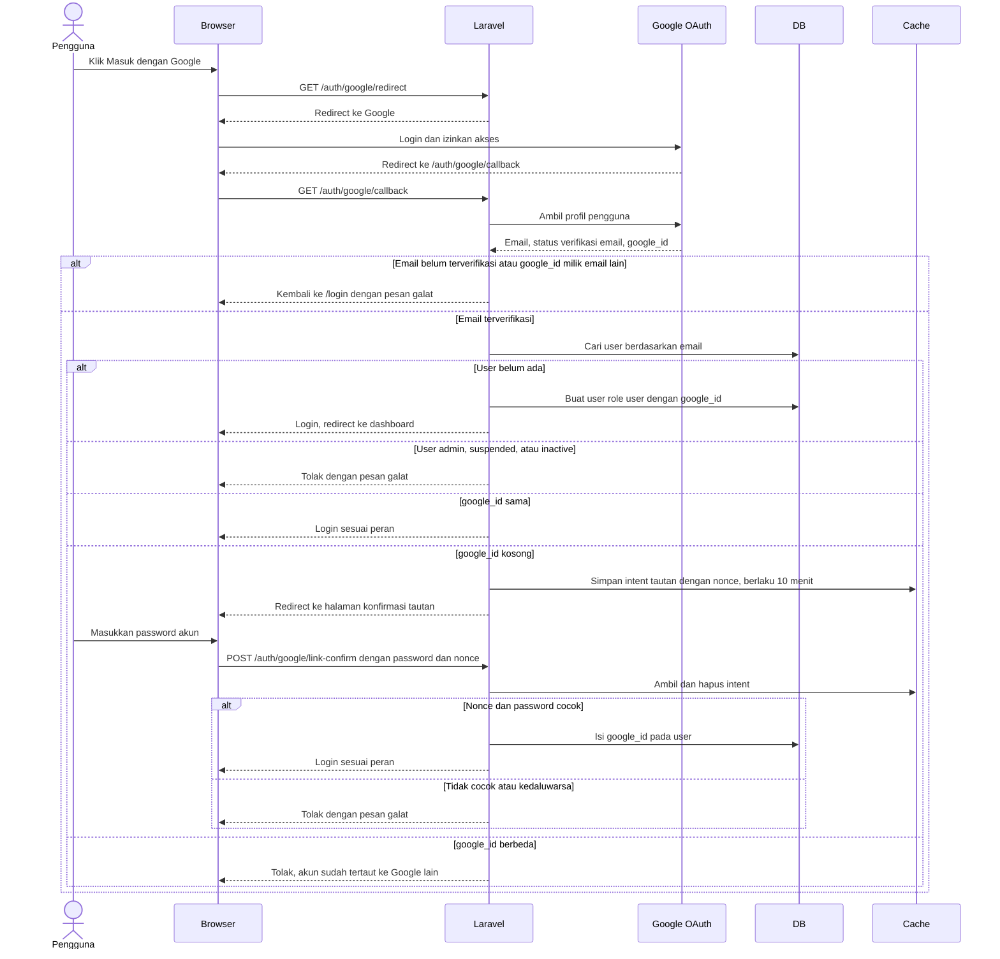

# Sequence 02 - Login dan Penautan Akun Google

| Field | Detail |
|---|---|
| Proses BW | 12. Akun dan Autentikasi |
| Aktor | Pengguna (pembeli atau pedagang) |
| Sumber | `app/Http/Controllers/Auth/SocialiteController.php`, `routes/web.php` (rute `/auth/google/*`), `docs/PANDUAN_AKUN_DAN_AUTENTIKASI.md` |

Setelah login, sesi diregenerasi. Pedagang diarahkan ke halaman penyiapan toko bila password awal belum diganti, atau ke dashboard pedagang. Peran lain diarahkan ke dashboard pembeli.
