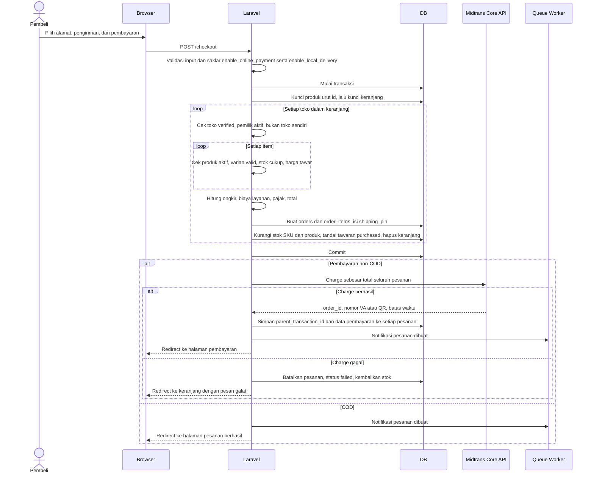

# Sequence 03 - Checkout dan Charge Midtrans

| Field | Detail |
|---|---|
| Proses BW | 3. Belanja dan Checkout |
| Aktor | Pembeli |
| Sumber | `app/Http/Controllers/CheckoutController.php` (`store`, `calculateShippingCost`), `app/Services/MidtransService.php` (`chargeCoreApi`), `app/Services/OrderNotificationService.php`, `app/Models/PlatformSetting.php` |

PIN serah terima dibuat saat pesanan dibuat dan dapat dibuat ulang saat pesanan dikirim bila masih kosong.
