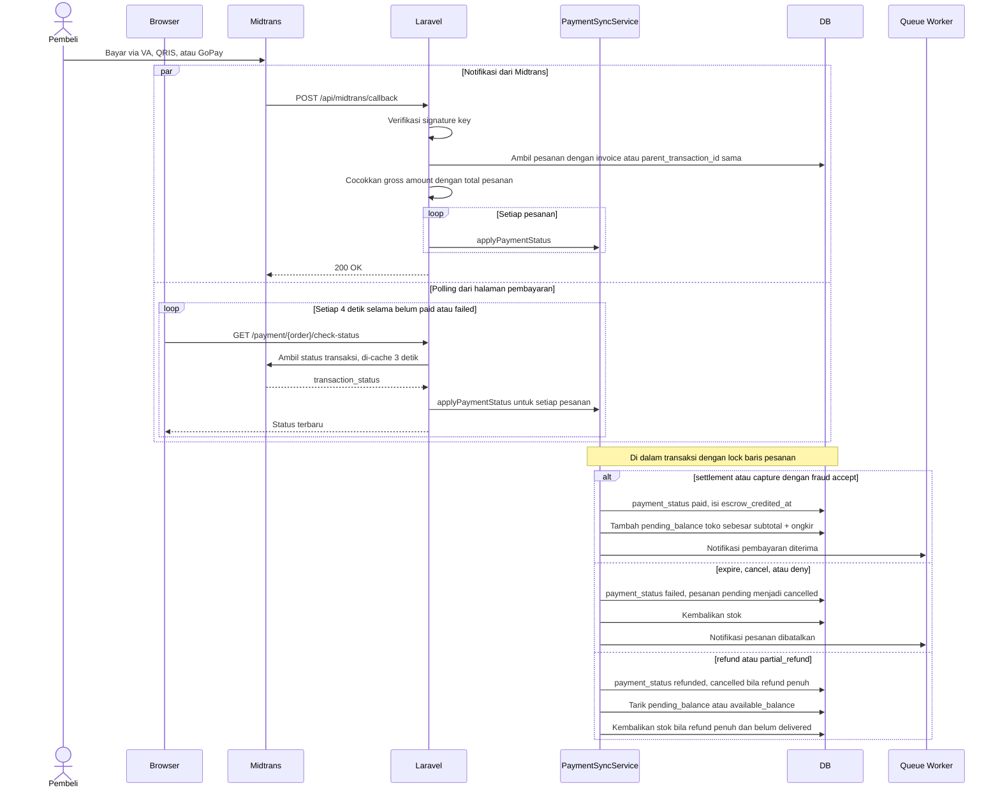

# Sequence 04 - Notifikasi Midtrans dan Kredit Escrow

| Field | Detail |
|---|---|
| Proses BW | 4. Pembayaran dan Escrow |
| Aktor | Pembeli, Midtrans |
| Sumber | `app/Http/Controllers/MidtransCallbackController.php`, `app/Http/Controllers/PaymentController.php` (`show`, `checkStatus`), `app/Services/PaymentSyncService.php` (`applyPaymentStatus`, `syncByMidtransOrderId`), `resources/js/Pages/Payment/Show.tsx` |

Notifikasi yang sama dapat diterima lebih dari sekali. Penanda `escrow_credited_at` mencegah saldo dikreditkan dua kali.
