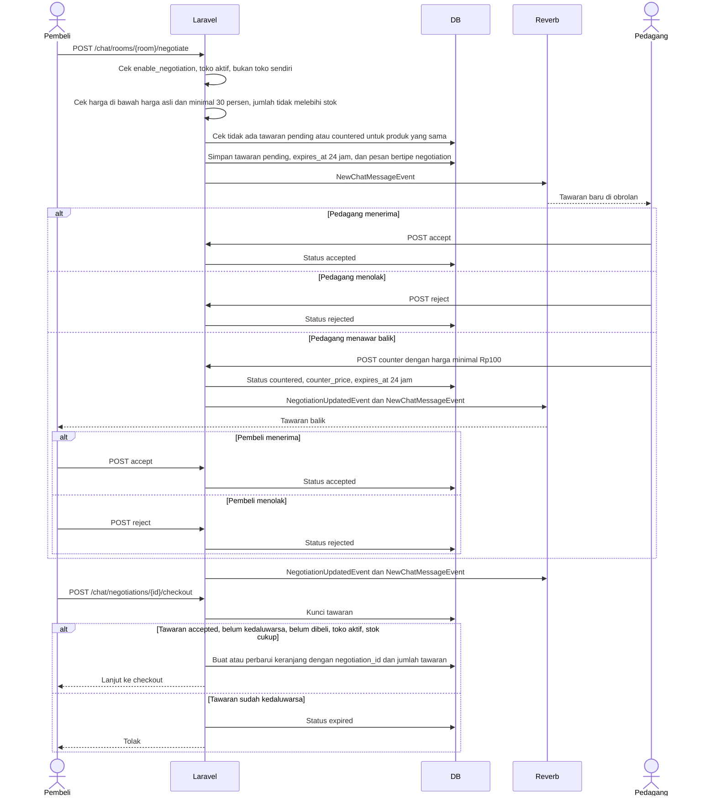

# Sequence 05 - Tawar-Menawar sampai Keranjang

| Field | Detail |
|---|---|
| Proses BW | 5. Tawar-Menawar Harga |
| Aktor | Pembeli, Pedagang |
| Sumber | `app/Http/Controllers/Storefront/NegotiationController.php` (`store`, `acceptCounter`, `rejectCounter`, `checkout`), `app/Http/Controllers/Merchant/NegotiationController.php` (`accept`, `reject`, `counter`), `app/Events/NegotiationUpdatedEvent.php`, `app/Events/NewChatMessageEvent.php` |

Tawaran berubah menjadi `purchased` saat checkout berhasil (Sequence 03), dan harga item pesanan memakai harga hasil tawar.
