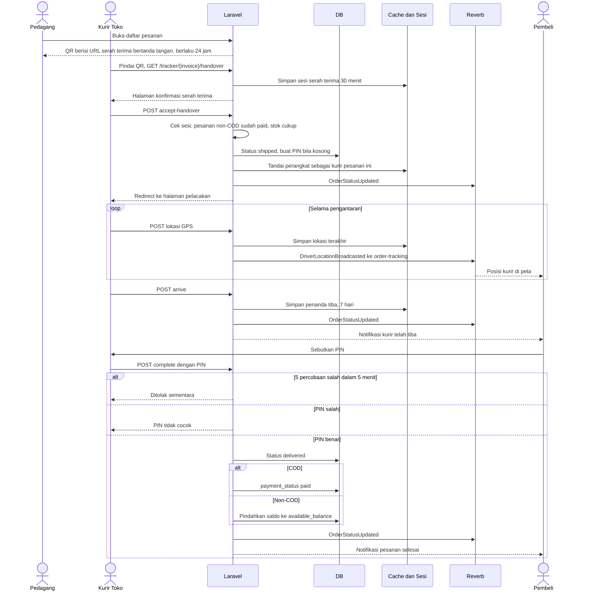

# Sequence 06 - Serah Terima, Pelacakan, dan PIN Kurir

| Field | Detail |
|---|---|
| Proses BW | 6. Pemrosesan Pesanan dan Pengiriman |
| Aktor | Pedagang, Kurir Toko, Pembeli |
| Sumber | `app/Http/Controllers/Merchant/OrderController.php` (`index`, `generateBatchHandover`), `app/Http/Controllers/DeliveryTrackerController.php` (`handover`, `acceptHandover`, `show`, `updateLocation`, `markArrived`, `complete`), `app/Events/OrderStatusUpdated.php`, `app/Events/DriverLocationBroadcasted.php` |

Serah terima batch memakai alur yang sama dengan satu QR induk (`/tracker/batch/{batch_token}`) untuk beberapa pesanan `local_delivery` dari toko yang sama. PIN tetap diverifikasi per pesanan.
