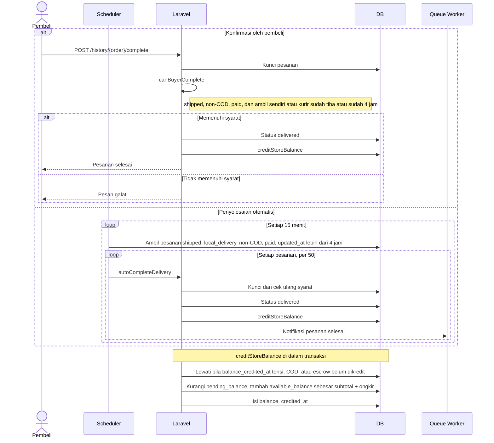

# Sequence 07 - Penyelesaian Pesanan dan Kredit Saldo

| Field | Detail |
|---|---|
| Proses BW | 7. Penyelesaian Pesanan dan Ulasan |
| Aktor | Pembeli, Scheduler |
| Sumber | `routes/console.php` (jadwal `auto-complete-shipped-orders`), `app/Models/Order.php` (`canBuyerComplete`, `autoCompleteDelivery`, `creditStoreBalance`), `app/Http/Controllers/OrderHistoryController.php` (`complete`) |

