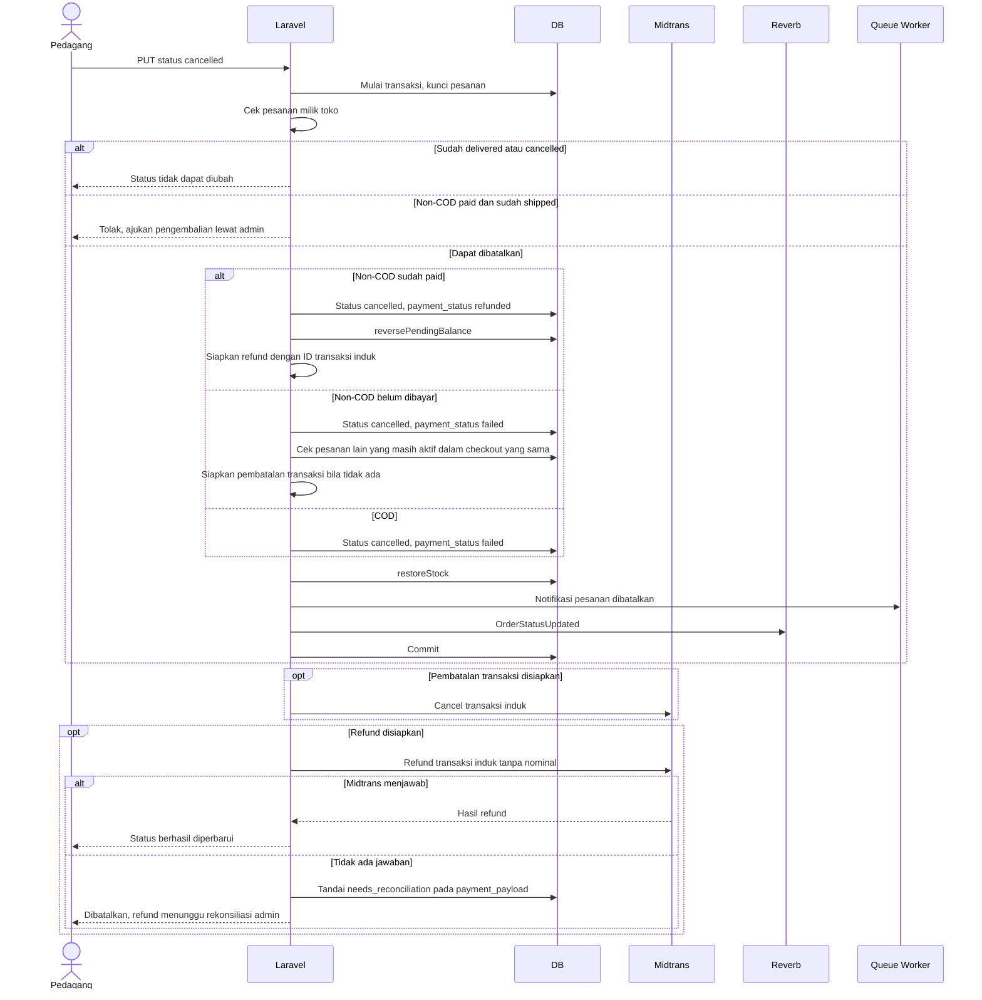

# Sequence 08 - Pembatalan oleh Pedagang dan Refund

| Field | Detail |
|---|---|
| Proses BW | 8. Pembatalan dan Pengembalian Dana |
| Aktor | Pedagang, Midtrans |
| Sumber | `app/Http/Controllers/Merchant/OrderController.php` (`updateStatus`), `app/Services/MidtransService.php` (`cancelTransaction`, `refundTransaction`), `app/Models/Order.php` (`reversePendingBalance`, `restoreStock`) |

Panggilan ke Midtrans dilakukan setelah transaksi database selesai. Notifikasi `refund` yang kemudian dikirim Midtrans diproses oleh Sequence 04.
