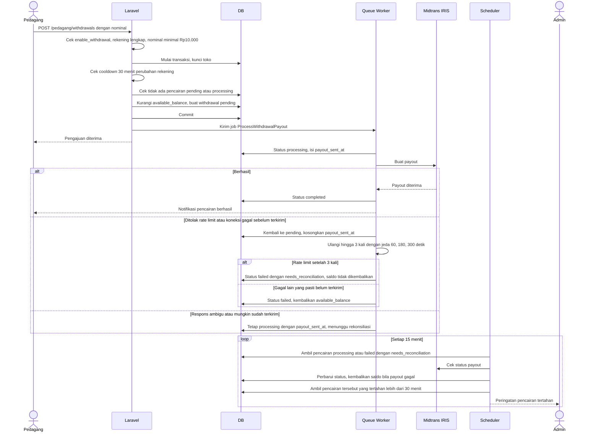

# Sequence 09 - Pencairan Dana dan Rekonsiliasi

| Field | Detail |
|---|---|
| Proses BW | 9. Pencairan Saldo Pedagang |
| Aktor | Pedagang, Scheduler, Admin |
| Sumber | `app/Http/Controllers/Merchant/WithdrawalController.php` (`store`), `app/Jobs/ProcessWithdrawalPayout.php`, `app/Services/MidtransIrisService.php`, `app/Console/Commands/ReconcileWithdrawals.php`, `app/Console/Commands/AlertStuckWithdrawals.php`, `routes/console.php` |

