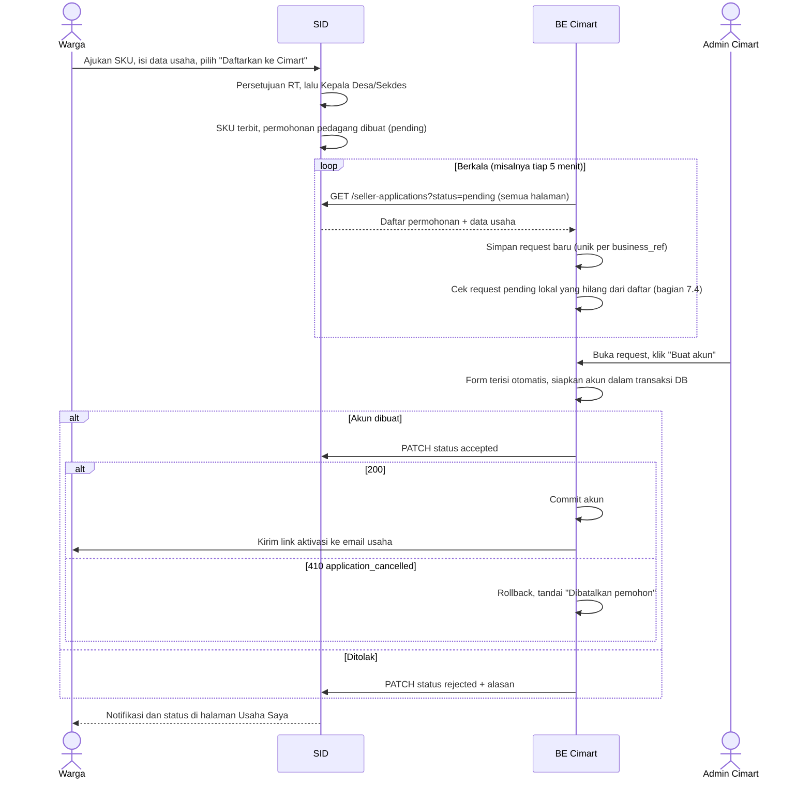

# Integrasi SIDUTama untuk Cimart

| | |
|---|---|
| **Status** | Disepakati tim SIDUTama dan Cimart, belum diimplementasikan |
| **Versi API** | v1 |
| **Tanggal** | 2026-11-12 |
| **Pemilik** | Tim SIDUTama |
| **Kontrak API** | [api-spec/openapi.yaml](api-spec/openapi.yaml) |

Dokumen ini menjelaskan cara Cimart menerima pendaftaran pedagang dari SIDUTama (SID): apa yang disediakan SID, alur pendaftarannya, cara autentikasi, dan apa yang menjadi tanggung jawab Cimart. Detail request dan response ada di kontrak API.

## 1. Ringkasan

Pedagang Cimart harus warga Desa Cibenda yang memiliki **Surat Keterangan Usaha (SKU)** terbitan SID. Pendaftaran pedagang dimulai dari SID:

1. Warga mengajukan SKU di SID, mengisi data usaha, lalu memilih **"Daftarkan sebagai pedagang Cimart"**.
2. Setelah SKU disetujui Kepala Desa, SID membuat **permohonan pedagang** dengan status `pending`.
3. Backend Cimart mengambil permohonan `pending` dari SID secara berkala.
4. Permohonan masuk ke dashboard admin Cimart. Admin membuat akun pedagang dengan form yang terisi otomatis dari data SID.
5. Cimart melaporkan hasilnya ke SID (`accepted` atau `rejected`), lalu warga melihat statusnya di SID.

Warga yang sudah punya SKU yang masih berlaku juga bisa mendaftar lewat tombol **"Daftarkan ke Cimart"** di halaman Usaha Saya di SID. Selama permohonan masih `pending`, warga boleh membatalkannya dari halaman yang sama.

SKU hanya menjadi syarat **saat mendaftar**. Setelah pedagang terdaftar, SKU yang kedaluwarsa tidak memengaruhi akun pedagang di Cimart.

## 2. Prinsip integrasi

- **Server ke server.** Yang memanggil API SID adalah backend Laravel Cimart, bukan browser atau halaman React/Inertia.
- **Bearer token, bukan session.** Session cookie SID dan session Cimart tidak dipakai untuk integrasi ini.
- **Satu token mewakili aplikasi Cimart.** Token tidak dibuat per warga, dan Cimart tidak didaftarkan sebagai user SID.
- **Kendali akses ada di SID.** Token hanya diterbitkan, dinonaktifkan, dan diganti dari SID.
- **Hanya data yang disetujui warga.** Cimart hanya bisa melihat usaha milik warga yang memilih mendaftar ke Cimart. Usaha lain di SID, misalnya SKU untuk pengajuan KUR ke bank, tidak pernah terlihat oleh Cimart.
- **Cimart yang mengambil data (pull).** SID tidak mengirim data ke Cimart. Cimart mengambil permohonan baru secara berkala, sehingga tidak perlu menyediakan endpoint publik untuk menerima kiriman.

## 3. Pembagian tanggung jawab

| Urusan | SID | Cimart |
|---|---|---|
| Penerbitan SKU dan alur persetujuannya | ✓ | |
| Pencatatan data usaha dari SKU | ✓ | |
| Pilihan warga untuk mendaftar ke Cimart (opt-in) dan membatalkannya | ✓ | |
| Menampilkan status pendaftaran ke warga | ✓ | |
| Penerbitan, penonaktifan, dan penggantian token | ✓ | |
| Penyimpanan token dengan aman | | ✓ |
| Mengambil permohonan secara berkala | | ✓ |
| Dashboard admin dan pembuatan akun pedagang | | ✓ |
| Melaporkan hasil (`accepted` / `rejected`) ke SID | | ✓ |
| Mendeteksi pembatalan dan menghapus data pribadi request yang dibatalkan | | ✓ |
| Pemetaan kategori SID ke kategori Cimart | | ✓ |
| Akun, login, dan otorisasi pengguna Cimart | | ✓ |

## 4. Autentikasi dan token

### 4.1 Cara kerja

```text
Scheduler / admin Cimart ──> BE Cimart ── Authorization: Bearer <token> ──> API SID
```

Setiap request ke SID wajib membawa header:

```http
Authorization: Bearer <token Cimart>
Accept: application/json
```

SID mengenali pemanggil sebagai **client integrasi Cimart**, bukan sebagai warga atau staf. Hak akses token ditentukan oleh **abilities** yang diberikan SID:

| Ability | Untuk |
|---|---|
| `seller-applications:read` | `GET /seller-applications` dan `GET /seller-applications/{business_ref}` |
| `seller-applications:update` | `PATCH /seller-applications/{business_ref}` |

`GET /ping` bisa dipakai oleh semua token yang aktif.

### 4.2 Mendapatkan token

1. Tim SID membuat client Cimart dan menerbitkan token.
2. Token **hanya ditampilkan sekali** di SID. SID sendiri hanya menyimpan hash-nya, jadi token tidak bisa dilihat ulang.
3. Staf SIDUTama menyerahkan token ke tim Cimart lewat jalur yang aman, jangan lewat grup chat.
4. Cimart menyimpan token, lalu menguji koneksi dengan `GET /ping`.

Token berbentuk string utuh seperti `9f1c...|Xk2...`. Simpan dan kirim seluruh string apa adanya, termasuk bagian sebelum tanda `|`.

### 4.3 Menyimpan token di Cimart

Ada dua pilihan, dan keputusannya ada di tim Cimart:

| | `.env` backend (default) | DB Cimart + halaman admin |
|---|---|---|
| Yang memperbarui token | Developer dengan akses server | Admin Cimart, tanpa akses server |
| Setelah diperbarui | Refresh cache konfigurasi (`php artisan config:cache`) | Langsung berlaku |
| Usaha pembuatan | Hampir tidak ada | Perlu tabel, halaman, dan otorisasi |

Aturan untuk kedua pilihan:

- **Token tidak boleh di-hash di Cimart.** Cimart harus mengirim nilai aslinya ke SID, sedangkan hash tidak bisa dikembalikan ke nilai asli. Kalau disimpan di DB, pakai enkripsi, misalnya cast `encrypted` di Laravel.
- **Token tidak boleh sampai ke browser.** Jangan menaruhnya di kode React, variabel `VITE_*`, atau props Inertia.
- **Token tidak boleh masuk log**, termasuk log request HTTP keluar.

Kalau memilih DB + halaman admin:

- Halaman hanya bisa **menimpa** token. Token lama tidak pernah ditampilkan lagi, cukup tampilkan status "Terpasang".
- Hanya admin Cimart yang boleh mengakses, dengan konfirmasi password dan audit log.
- Uji token baru ke `GET /ping` sebelum disimpan, supaya salah salin tidak memutus integrasi.
- Kalau `APP_KEY` Cimart diganti, token yang terenkripsi harus dimasukkan ulang.

### 4.4 Penonaktifan dan penggantian token

Semua aksi ini dilakukan di SID oleh Staf SIDUTama:

| Kejadian | Yang terjadi |
|---|---|
| Client dinonaktifkan | Semua request ditolak dengan `403 integration_disabled` sampai diaktifkan kembali. Token tidak perlu diganti |
| Penggantian token rutin | SID menerbitkan token baru, dan **token lama tetap berlaku** sampai Cimart selesai memperbaruinya. Setelah token baru terlihat dipakai, SID mencabut token lama. Tidak ada downtime |
| Token bocor | SID langsung mencabut token lama, lalu menerbitkan token baru. Integrasi berhenti sampai Cimart memasang token baru |

Cimart boleh punya saklar sendiri, misalnya `SID_INTEGRATION_ENABLED=false` saat maintenance. Saklar ini hanya menghentikan Cimart memanggil SID, tanpa mengubah izin di SID.

### 4.5 Contoh pemanggilan (Laravel)

```php
// config/services.php
'sid' => [
    'url' => env('SID_API_URL'),       // https://<domain-sid>/api/integrations/v1
    'token' => env('SID_API_TOKEN'),
    'enabled' => env('SID_INTEGRATION_ENABLED', true),
],
```

```php
$sid = Http::baseUrl(config('services.sid.url'))
    ->withToken(config('services.sid.token'))
    ->acceptJson()
    ->timeout(10);

// Ambil seluruh permohonan pending (dijalankan scheduler, ulangi untuk setiap halaman)
$response = $sid->get('/seller-applications', [
    'status' => 'pending',
    'page' => 1,
]);

// Laporkan hasil setelah admin memproses permohonan
$sid->patch("/seller-applications/{$businessRef}", [
    'status' => 'rejected',
    'note' => 'Foto usaha tidak sesuai dengan kategori yang dipilih.',
]);
```

## 5. Data usaha dari SKU

Saat mengajukan SKU di SID, warga mengisi field berikut:

| Field form SKU | Tercetak di surat | Dikirim ke Cimart sebagai |
|---|---|---|
| Kegiatan Usaha, misalnya "Warung kopi" | Ya | `business_activity` |
| Nama Usaha | Tidak | `business_name` |
| Kategori Usaha | Tidak | `category`, `category_label` |
| Alamat Usaha | Tidak | `address` |
| Email Usaha | Tidak | `email` |
| Nomor HP Usaha | Tidak | `phone` |
| Foto Usaha Terkini | Tidak | Tidak dikirim, hanya untuk pertimbangan RT dan Kepala Desa |
| Daftarkan sebagai pedagang Cimart (Ya/Tidak) | Tidak | Tidak dikirim. Hanya permohonan yang dijawab "Ya" yang terlihat oleh Cimart |

Email dan nomor HP usaha **terpisah** dari email profil akun warga di SID.

Kategori dari SID:

| `category` | `category_label` |
|---|---|
| `kelontong` | Toko Kelontong |
| `kuliner` | Toko Kuliner |
| `non_kuliner` | Toko Non Kuliner |

Cimart punya kategori sendiri, jadi Cimart yang memetakan kategori SID ke kategorinya. SID menjamin **kode** kategori tidak berubah di v1, sedangkan label bisa saja diperbarui.

Data usaha dicatat sekali, saat SKU terbit, dan **tidak bisa diubah** dari SID maupun dari Cimart. Kalau email atau nomor HP usaha berubah setelah pedagang terdaftar, pedagang memperbaruinya di Cimart, karena Cimart sudah menyimpan salinannya sendiri.

Satu warga boleh memiliki beberapa SKU untuk usaha yang berbeda. Setiap SKU menghasilkan satu data usaha dengan `business_ref` sendiri, dan setiap data usaha bisa didaftarkan ke Cimart secara terpisah.

## 6. Alur pendaftaran pedagang



Langkah rinci:

1. **Pendaftaran di SID.** Warga login ke SID, memilih Surat Keterangan Usaha, mengisi data usaha, lalu menjawab **"Ya"** pada pilihan "Daftarkan sebagai pedagang Cimart". Calon pedagang **butuh akun SID** untuk langkah ini.
2. **Persetujuan SID.** Surat disetujui RT, lalu Kepala Desa atau Sekretaris Desa. Setelah persetujuan akhir, nomor surat terbit dan SID membuat permohonan pedagang berstatus `pending`.
3. **Pengambilan oleh Cimart.** Scheduler Cimart mengambil **seluruh** daftar `GET /seller-applications?status=pending`, semua halaman, secara berkala. Admin juga boleh memicu pengambilan saat membuka dashboard.
4. **Tabel request Cimart.**
   - Cimart menyimpan setiap permohonan dengan `business_ref` sebagai kunci unik, supaya permohonan yang sama tidak masuk dua kali.
   - Request `pending` di Cimart yang tidak ada lagi di daftar SID diperiksa sesuai [bagian 7.4](#74-pembatalan-oleh-warga).
5. **Pembuatan akun.**
   - Admin Cimart membuka request dan membuat akun dengan form yang terisi otomatis.
   - Cimart menyiapkan akun di dalam transaksi DB, lalu memanggil `PATCH` dengan status `accepted`.
   - Akun baru di-commit dan link aktivasi baru dikirim setelah SID menjawab `200`.
   - Lihat juga [saran soal password di bagian 10](#10-kewajiban-dan-saran-untuk-cimart).
6. **Laporan hasil.** Cimart memanggil `PATCH /seller-applications/{business_ref}`:
   - `accepted` saat akun pedagang dibuat.
   - `rejected` disertai alasan yang bisa dipahami warga.
7. **Status di SID.** Warga mendapat notifikasi, dan status serta alasan penolakannya tampil di halaman Usaha Saya.

## 7. Aturan pendaftaran dan status

### 7.1 Cara warga mendaftar

| Jalur | Kapan | Syarat |
|---|---|---|
| Pilihan "Ya" di form SKU | Saat mengajukan SKU baru | Permohonan dibuat otomatis saat SKU terbit |
| Tombol "Daftarkan ke Cimart" di Usaha Saya | Kapan saja setelah SKU terbit | SKU masih berlaku, dan usaha itu belum pernah didaftarkan, atau permohonan sebelumnya ditolak atau dibatalkan |

SKU harus berlaku **saat warga mendaftar**. Permohonan yang sudah `pending` tetap ada dan tetap bisa diproses Cimart walaupun SKU-nya kedaluwarsa selama menunggu.

### 7.2 Status permohonan

```text
(belum mendaftar) ──daftar──> pending ──Cimart──> accepted
                                 │
                                 ├──Cimart──> rejected  ──daftar ulang──> pending
                                 │
                                 └──warga───> cancelled ──daftar ulang──> pending
```

| Status | Arti | Yang dilihat warga di SID |
|---|---|---|
| `pending` | Menunggu diproses Cimart | "Menunggu diproses Cimart" |
| `accepted` | Akun pedagang sudah dibuat Cimart | "Akun pedagang sudah dibuat" |
| `rejected` | Ditolak Cimart | "Ditolak", beserta alasan dari Cimart |
| `cancelled` | Dibatalkan warga sebelum diproses Cimart | "Pendaftaran dibatalkan" |

Status `cancelled` tidak pernah dikirim ke Cimart dalam bentuk data. Permohonan yang dibatalkan hilang dari daftar, dan endpoint detail serta `PATCH` menjawab `410 application_cancelled`. Lihat [bagian 7.4](#74-pembatalan-oleh-warga).

Aturan perubahan status oleh Cimart:

- **Hanya dari `pending`.** Cimart hanya bisa mengubah permohonan `pending` menjadi `accepted` atau `rejected`.
- **Aman diulang.** Mengirim status yang sama untuk permohonan yang sudah berstatus itu mengembalikan `200` tanpa perubahan, sehingga retry jaringan aman.
- **Tidak bisa dibalik.** Mengubah `accepted` menjadi `rejected`, atau sebaliknya, ditolak dengan `409 application_already_processed`.
- **Permohonan yang dibatalkan tidak bisa diubah.** `PATCH` untuk permohonan `cancelled` ditolak dengan `410 application_cancelled`.
- **Alasan penolakan wajib.** Status `rejected` harus disertai `note`, maksimal 500 karakter. Alasan ini **ditampilkan ke warga**, jadi tulis dengan bahasa yang sopan dan jelas, tanpa informasi internal.

### 7.3 Daftar ulang setelah ditolak atau dibatalkan

Warga boleh mendaftar ulang lewat tombol di Usaha Saya selama SKU-nya masih berlaku. Permohonan kembali menjadi `pending` dengan `business_ref` yang sama dan `requested_at` yang baru.

Karena data usaha tidak bisa diubah, penolakan karena kesalahan data, misalnya email salah, hanya bisa diperbaiki dengan mengajukan SKU baru.

Cimart harus siap menerima `business_ref` yang pernah ditolak atau dibatalkan muncul kembali sebagai `pending`. Perbarui baris request yang sudah ada dengan data terbaru, jangan membuat baris baru.

### 7.4 Pembatalan oleh warga

Warga boleh membatalkan permohonan **selama statusnya masih `pending`**, lewat tombol **Batalkan pendaftaran** di Usaha Saya. Setelah dibatalkan, persetujuan warga untuk berbagi data dianggap dicabut.

**Di SID:**

- Status berubah menjadi `cancelled`, dan permohonan tidak lagi muncul di daftar `pending`.
- Endpoint detail dan `PATCH` menjawab `410 application_cancelled`, tanpa data pribadi.
- Warga boleh mendaftar lagi selama SKU masih berlaku ([bagian 7.3](#73-daftar-ulang-setelah-ditolak-atau-dibatalkan)).

**Cimart mendeteksi pembatalan saat sinkronisasi.** Setiap sinkronisasi, bandingkan request `pending` di DB Cimart dengan seluruh daftar `pending` dari SID:

```text
Request pending di Cimart yang tidak ada lagi di daftar SID
  → GET /seller-applications/{business_ref}
  → 410 application_cancelled   : tandai "Dibatalkan pemohon", hapus data pribadinya
  → 200 accepted / rejected     : samakan status dengan SID
```

Karena itu, sinkronisasi ini harus mengambil **seluruh** daftar `pending` tanpa parameter `since`. Jumlah permohonan dalam satu desa kecil, jadi tidak membebani.

**`PATCH accepted` adalah kunci terakhir.** Warga bisa saja membatalkan tepat saat admin Cimart sedang membuat akun. SID memproses pembatalan dan `PATCH` secara bergantian, jadi hanya salah satu yang menang:

| Yang lebih dulu | Hasil |
|---|---|
| Warga membatalkan | `PATCH accepted` ditolak dengan `410`. Cimart me-rollback akun yang sedang disiapkan |
| Cimart menerima | Pembatalan di SID ditolak. Warga melihat "Akun sudah dibuat, hubungi Cimart untuk menghapus akun" |

Karena itu, Cimart baru boleh meng-commit akun dan mengirim link aktivasi **setelah** `PATCH accepted` dijawab `200`.

**Kewajiban Cimart untuk request yang dibatalkan:**

- Tidak membuat akun, dan menghentikan proses yang sedang berjalan.
- Menghapus data pribadi request tersebut: NIK, nama, email, nomor HP, dan alamat. Yang boleh disimpan untuk audit hanya `business_ref`, status "Dibatalkan pemohon", dan waktunya.
- Kalau `business_ref` itu muncul lagi sebagai `pending`, perbarui request tersebut dengan data baru.

Pembatalan setelah akun dibuat (`accepted`) tidak dilakukan lewat SID. Penghapusan akun pedagang menjadi urusan Cimart.

### 7.5 Setelah pedagang terdaftar

- **Satu `business_ref` untuk satu akun pedagang.**
- **Tidak ada pengecekan ulang ke SID.** SKU yang kedaluwarsa setelah pedagang terdaftar tidak berpengaruh.
- **Data terbaru opsional.** Cimart boleh memanggil `GET /seller-applications/{business_ref}` kapan saja untuk melihat data terbaru, selama permohonannya tidak dibatalkan.

## 8. Daftar endpoint

Base URL: `https://<domain-sid>/api/integrations/v1`. Domain final menyusul.

| Method | Path | Ability | Fungsi |
|---|---|---|---|
| `GET` | `/ping` | Semua token aktif | Tes koneksi dan token |
| `GET` | `/seller-applications` | `seller-applications:read` | Daftar permohonan pedagang, berhalaman, dengan filter `status` dan `since` |
| `GET` | `/seller-applications/{business_ref}` | `seller-applications:read` | Detail satu permohonan |
| `PATCH` | `/seller-applications/{business_ref}` | `seller-applications:update` | Laporkan hasil: `accepted` atau `rejected` dengan alasan |

Saran pengambilan berkala:

- Panggil `GET /seller-applications?status=pending` tiap beberapa menit, misalnya 5 menit, dan ambil semua halaman.
- Hasil diurutkan dari permohonan paling lama (`requested_at` naik), seperti antrean.
- Untuk sinkronisasi rutin, **jangan pakai `since`**, karena pembatalan hanya terdeteksi dari seluruh daftar `pending` ([bagian 7.4](#74-pembatalan-oleh-warga)). Parameter `since` hanya untuk pengecekan tambahan, misalnya mengambil permohonan baru lebih sering di antara sinkronisasi penuh.

Skema lengkap, contoh, dan kode error ada di [api-spec/openapi.yaml](api-spec/openapi.yaml).

**Versi API.** Di v1, SID bisa **menambah** field baru di respons tanpa pemberitahuan, jadi Cimart harus mengabaikan field yang tidak dikenal. Perubahan yang merusak kompatibilitas, misalnya menghapus atau mengganti nama field, hanya dilakukan di versi baru (`/v2`) dan diinformasikan lebih dulu.

## 9. Penanganan error dan ketersediaan

| HTTP | `code` | Arti | Tindakan Cimart |
|---|---|---|---|
| 200 | | Berhasil | Lanjutkan |
| 401 | | Token tidak ada, salah, atau sudah dicabut | Periksa token. Jangan retry |
| 403 | `integration_disabled` | Client Cimart dinonaktifkan SID | Hentikan pengambilan sementara, lalu hubungi tim SID |
| 403 | `ability_forbidden` | Token tidak punya ability untuk endpoint ini | Hubungi tim SID |
| 404 | | `business_ref` tidak dikenal atau tidak didaftarkan ke Cimart | Tandai datanya untuk dicek admin Cimart |
| 409 | `application_already_processed` | Permohonan sudah diproses dengan status lain | Ambil detail terbaru, lalu sesuaikan data di Cimart |
| 410 | `application_cancelled` | Permohonan dibatalkan warga | Jangan buat akun. Rollback akun yang sedang disiapkan, tandai "Dibatalkan pemohon", dan hapus data pribadinya |
| 422 | | Input salah, misalnya `note` kosong saat `rejected` | Perbaiki request, lihat `errors` |
| 429 | `too_many_attempts` | Melewati batas request | Tunggu sesuai header `Retry-After` |
| 5xx / timeout | | SID sedang bermasalah | Coba lagi di jadwal pengambilan berikutnya |

Aturan umum:

- **Gunakan HTTP status dan `code`, bukan isi `message`.** Pesan dalam bahasa Indonesia dan bisa berubah.
- **SID mati tidak menghilangkan permohonan.** Permohonan tetap `pending` di SID sampai Cimart berhasil mengambil dan memprosesnya.
- **Status yang gagal dilaporkan dikirim ulang.** Kalau `PATCH` gagal karena timeout atau 5xx, kirim ulang. Ini aman karena status yang sama tidak diproses dua kali.
- **Batas request (nilai awal, bisa berubah):** 60 request per menit untuk client Cimart. Selalu baca `Retry-After` saat menerima 429.

## 10. Kewajiban dan saran untuk Cimart

Wajib:

- [ ] Token disimpan di backend: `.env`, atau DB dengan enkripsi. Tidak di-hash, tidak sampai ke browser, dan tidak masuk log.
- [ ] Semua pemanggilan ke SID dilakukan dari backend lewat HTTPS.
- [ ] Seluruh daftar permohonan `pending` diambil secara berkala, dengan semua halaman ikut diproses.
- [ ] `business_ref` disimpan sebagai kunci unik request dan akun pedagang, termasuk menangani daftar ulang ([bagian 7.3](#73-daftar-ulang-setelah-ditolak-atau-dibatalkan)).
- [ ] Pembatalan oleh warga dideteksi, dan data pribadi request yang dibatalkan dihapus ([bagian 7.4](#74-pembatalan-oleh-warga)).
- [ ] Akun pedagang baru di-commit dan link aktivasi baru dikirim setelah `PATCH accepted` dijawab `200`.
- [ ] Setiap permohonan yang diproses dilaporkan ke SID (`accepted` atau `rejected`), dengan alasan penolakan yang bisa dipahami warga.
- [ ] Kategori SID dipetakan ke kategori Cimart.
- [ ] Error dan saat SID tidak tersedia ditangani sesuai [bagian 9](#9-penanganan-error-dan-ketersediaan).
- [ ] NIK tidak ditulis ke log aplikasi.
- [ ] Data pribadi dari SID hanya dipakai untuk pendaftaran dan operasional pedagang Cimart.

Saran:

- **Kirim link aktivasi ke email usaha, jangan password buatan admin.** Saat admin klik "Buat akun", Cimart mengirim link ke email usaha, lalu pedagang membuat password sendiri. Admin tidak perlu tahu password pedagang, password tidak beredar lewat chat, dan email usaha sekaligus terbukti aktif. Langkah admin tidak bertambah.

## 11. Di luar cakupan v1

| Tidak disediakan | Alasan |
|---|---|
| Webhook dari SID ke Cimart | Pengambilan berkala lebih sederhana di kedua sisi, dan jeda beberapa menit tidak masalah karena admin memproses secara manual |
| Data usaha warga yang tidak mendaftar ke Cimart | Usaha di SID juga dipakai untuk keperluan lain, misalnya pengajuan KUR. Hanya yang memilih mendaftar yang terlihat oleh Cimart |
| Pendaftaran dari Cimart dengan NIK + nomor surat | Diganti pendaftaran dari SID, karena warga sudah terbukti identitasnya lewat login SID |
| Login dengan akun SID (SSO) | Belum dibutuhkan |
| Akses lewat session cookie SID | Integrasi ini server ke server |
| Pengajuan SKU dari dalam Cimart | SKU memakai alur persetujuan SID |
| Perubahan data usaha dari Cimart | Data berasal dari surat yang sudah disahkan Kepala Desa |
| Verifikasi pembeli sebagai warga desa | Belum dibutuhkan di v1. Kalau nanti diperlukan, SID akan menambah endpoint dengan ability tersendiri |
| Integrasi dashboard desa | Dibahas terpisah |

## 12. Riwayat dokumen

| Tanggal | Perubahan |
|---|---|
| 2026-11-10 | Versi pertama: pendaftaran dari Cimart dengan verifikasi NIK + nomor surat |
| 2026-11-12 | Alur diganti menjadi pendaftaran dari SID (opt-in), pengambilan berkala oleh Cimart, dan laporan status balik ke SID. Endpoint `POST /businesses/verify` dan `GET /businesses/{business_ref}` diganti `/seller-applications` |
| 2026-11-12 | Daftar ulang dan pembatalan oleh warga disepakati: status `cancelled`, respons `410 application_cancelled`, sinkronisasi pembatalan, dan `PATCH accepted` sebagai kunci terakhir. Daftar hal yang masih terbuka ditutup |
